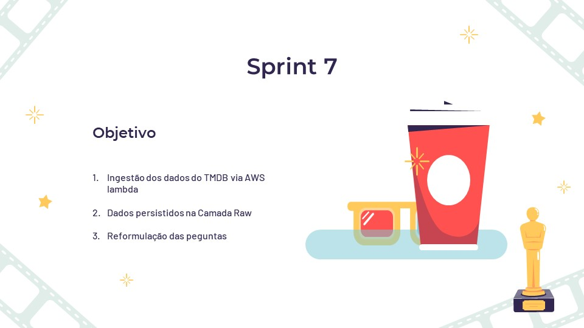
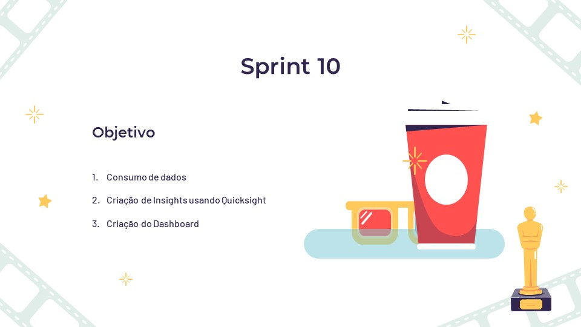
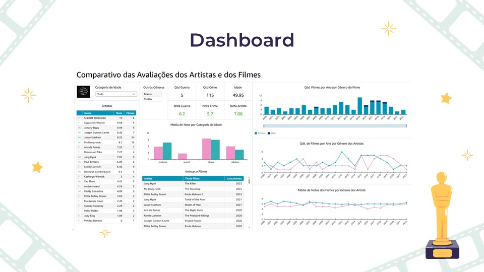
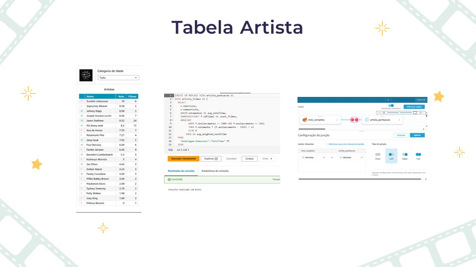
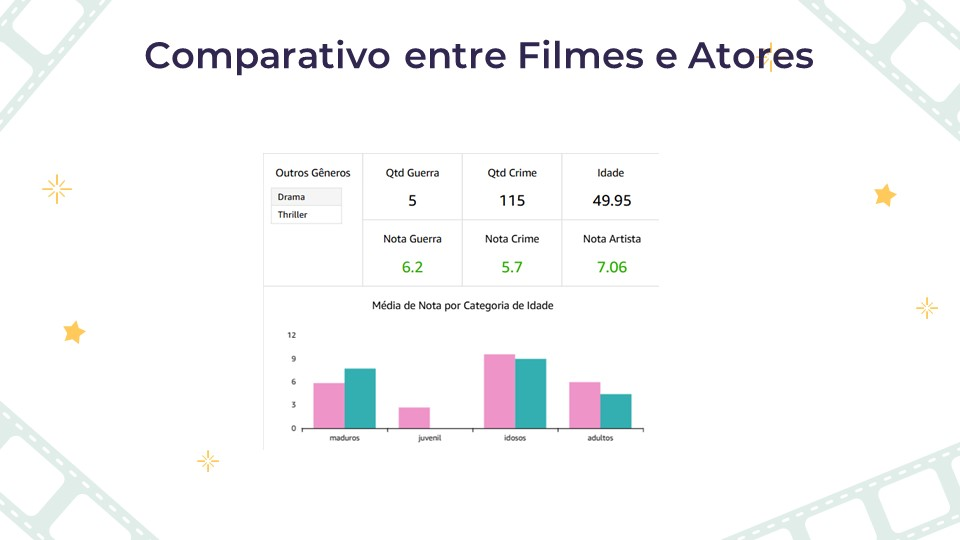
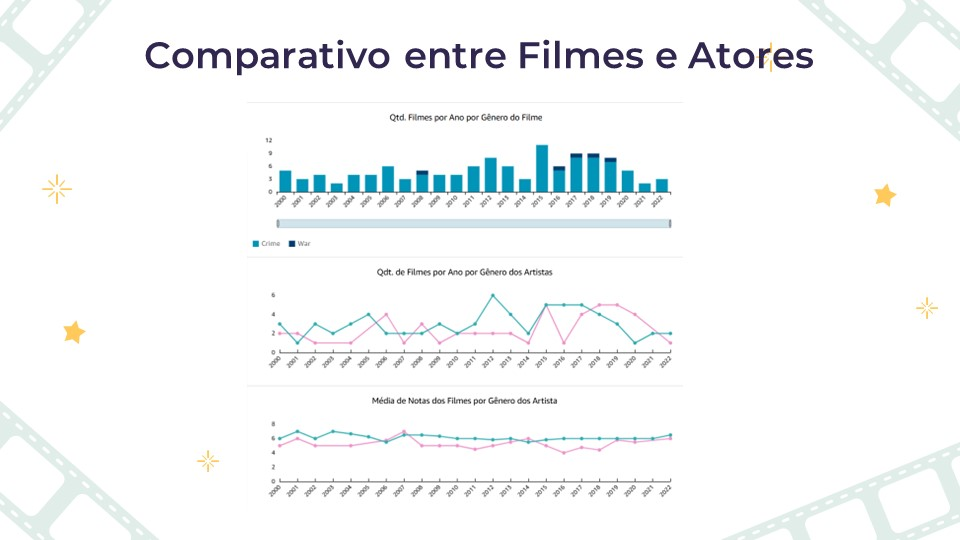
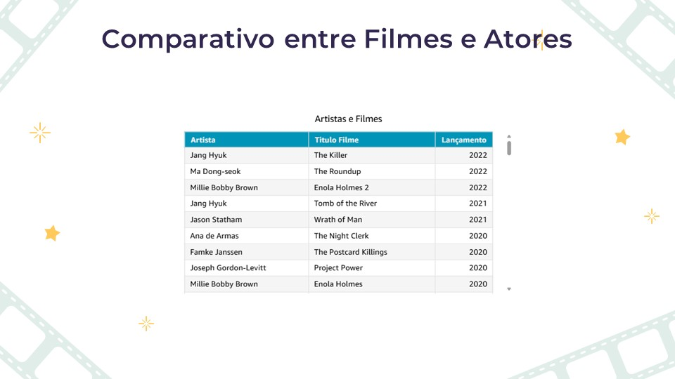

# Sprit 10 Desafio Final

[Etapas da contrução do desafio](#introdução)
  - [Sprint 6](#sprint-6)
  - [Sprint 7](#sprint-7)
  - [Sprint 8](#sprint-8)
  - [Sprint 9](#sprint-9)
  - [Desafio Final](#desafio-final)
  - [Dashboard](#dashboard)
  - [Código da pontuação dos Artistas](#código-dapontuação-dos-artistas)


# Introdução

Para essa etapa decidi fazer uma apresentação mostrando todos os detalhes da construção do desafio final. Fiz o dashboard. Gostei bastante dessa etapa. Foi uma etapa até mais tranquila, pois já tinha um curso de PowerBI. 

Acedito que posso dizer que evolui bastante durante a produção do desafio. Foi muito gratificante ter a oportunidade de ir além do aprendizado adiquirido dentro da sala de aula. Gostei de usar a AWS, apesar de ter tido um pouco de dificuldade na Sprint 8 com o script do glue. Como havia mencionado naquela etapa, foquei demais no curso de Spark, deveria ter focado na documentação do GLUE também.

Mas posso dizer que aprendi a usar a ferramenta, conseguir ter uma bo noção do trabalho de um Eng. e um Análista de Dados. Espero ter atendido as expectativas do programa, definitivamente o programa de bolsas atingiu minhas expectativas.

Muito obrigada pela oportunidade e espero ter a oportunidade de atuar na Compass e colocar em prática tudo que aprendi!!!


## Sprint 6
[sprint 6](../../Sprint6/evidencias/evidencias_desafio.md)


## Sprint 7
[sprint 7](../../Sprint7/evidencias/desafio_07.md)


## Sprint 8
[sprint 8](../../Sprint8/evidencias/desafio_8.md)


## Sprint 9
[sprint 9](../../Sprint9/evidencias/desafio_sprint_9.md)


## Desafio Final






## Dashboard

[dashboard](../desafio/dashboard_pamelaborelli.pdf)





## Código dapontuação dos artistas

```
CREATE OR REPLACE VIEW artista_pontuacao AS
WITH artista_filmes AS (
  SELECT
    e.idartista,
    e.nomeartista,
    AVG(f.notamedia) AS avg_notafilme,
    COUNT(DISTINCT f.idfilme) AS count_filmes,
    AVG(CASE
          WHEN f.anolancamento >= 2000 AND f.anolancamento <= 2022
          THEN f.notamedia * (f.anolancamento - 1999) / 23
          ELSE 0
        END) AS avg_weighted_notafilme
  FROM
    "modelagem-dimensoes"."fatofilme" ff
  JOIN
    "modelagem-dimensoes"."dimelencopersonagem" e ON ff.idelenco = e.idelenco
  JOIN
    "modelagem-dimensoes"."dimfilme" f ON ff.idfilme = f.idfilme
  GROUP BY
    e.idartista,
    e.nomeartista
),
artista_pontuacao_raw AS (
  SELECT
    e.idartista,
    e.nomeartista,
    (e.avaliacaoartista * 0.2 +
     af.avg_notafilme * 0.5 +
     af.count_filmes * 0.2 +
     af.avg_weighted_notafilme * 0.1) *
    CASE
      WHEN af.count_filmes < 5 THEN POW(af.count_filmes / 5.0, 0.5)
      ELSE 1.0
    END AS pontuacao_ajustada
  FROM
    "modelagem-dimensoes"."dimelencopersonagem" e
  JOIN
    artista_filmes af ON e.idartista = af.idartista
),
min_max_pontuacao AS (
  SELECT
    MIN(pontuacao_ajustada) AS min_pontuacao,
    MAX(pontuacao_ajustada) AS max_pontuacao
  FROM
    artista_pontuacao_raw
)
SELECT DISTINCT
  ar.idartista,
  ar.nomeartista,
  ROUND(
    10 * (ar.pontuacao_ajustada - mm.min_pontuacao) / 
    NULLIF(mm.max_pontuacao - mm.min_pontuacao, 0),
    2
  ) AS pontuacao_normalizada
FROM
  artista_pontuacao_raw ar
JOIN
  min_max_pontuacao mm
ON
  1 = 1;
```





