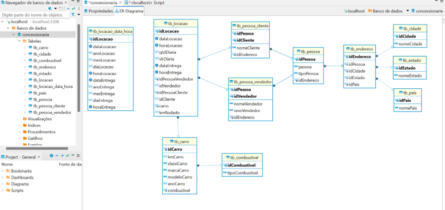
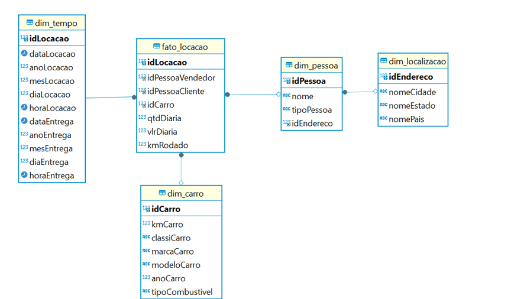
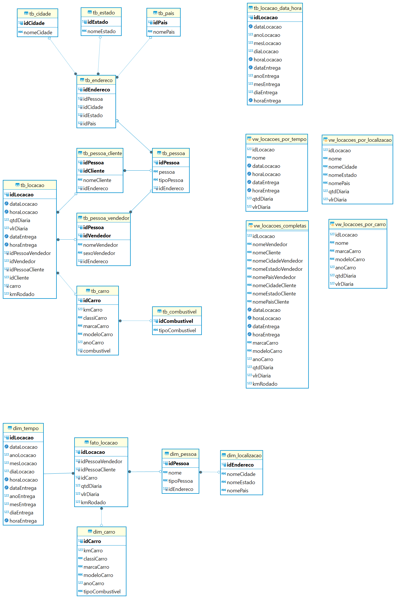

# Relatório de evidências Sprint 2

# Etapas da construção do desafio

- [INTRODUÇÃO](#introdução)
- 1-[ Normalização dos dados](#1--normalização-dos-dados)
    - [1 Abrindo o Dbeaver](#1--abrindo-o-dbeaver)
    - [2 Criando tb_combustivel](#2--criando-tb_combustivel)
    - [3 Backup da tabela tb_locacao](#3--backup-da-tabela-tb_locacao)
    - [4 Criando tb_endereco](#4--criando-tb_endereco)
    - [5 Criando tb_pessoa](#5--criando-tb_pessoa)
    - [6 Tabelas tb_pessoa-vendedor e tb_pessoa_cliente](#6--tabelas-tb_pessoa-vendedor-e-tb_pessoa_cliente)
    - [7 Deleção de tabelas temporárias tb_cliente e tb_vendedor](#7--deleção-de-tabelas-temporárias-tb_cliente-e-tb_vendedor)
    - [8 Correção da organização dos endereços e suas referências](#8--correção-da-organização-dos-endereços-e-suas-referências)
        - [1 Alteração das referências na tabela tb_pessoa_cliente](#1--alteração-das-referências-na-tabela-tb_pessoa_cliente)
        - [2 Alteração das referências na tabela tb_pessoa_vendedor](#2--alteração-das-referências-na-tabela-tb_pessoa_vendedor)
        - [3 Alteração das referências na tabela tb_pessoa](#3º-alteração-das-referências-na-tabela-tb_pessoa)
        - [4 Alterando referências na tabela tb_pessoa_cliente](#4º-alterando-referências-na-tabela-tb_pessoa_cliente)
    - [9 Criação da tabela tb_carro](#9--criação-da-tabela-tb_carro)
    - [10 Criação da tabela tb_locacao_normalizada](#10--criação-da-tabela-tb_locacao_normalizada)
    - [11 KmRodado](#11-kmrodado)
        - [1 Criação de trigger](#1--criação-de-triggerria)
    - [12 Criação da tabela tb_locacao_data_hora](#12-criaçao-da-tabela-tb_locacao_data_hora)
        - [1 Criação trigger](#1--criação-trigger)
    - [13 Deleção renomeação de tabelas](#13--deleção-renomeação-de-tabelas)
    - [14 Resultado da normalização](#14--resultado-da-normalização)
- [2 – Criação das dimensões](#2--criação-das-dimensões)
    - [1 dim_localizacao](#1--dim_localizacao)
    - [2 dim_pessoa](#2--dim_pessoa)
    - [3 dim_tempo](#3--dim_tempo)
    - [4 dim_carro](#4--dim_carro)
    - [5 fato_locacao](#5--fato_locacao)
    - [6 Resultado das dimensões](#6--resultado-das-dimensões)
- [3- Criando views](#3--criando-views)
    - [1- vw_locacoes_por_localizacao](#1--vw_locacoes_localizacao)
    - [2- vw_locacoes_por_tempo](#2--vw_locacoes_por_tempo)
    - [3- vw_locacoes_por_carro](#3--vw_locacoes_por_carro)
    - [4-vw_locacoes_completas](#4--vw_locacoes_completas)
- [4- Resultado Final](#4--resultado-final)


## INTRODUÇÃO

Nesse desafio o mais difícil para mim foi organizar as tabelas de acordo com o que eu havia determinado no começo. Realizei um esboço do Diagrama Entidade Relacionamento.
Parecia fácil e não demorei para realizar o esboço, porém à medida que o exercício foi sendo elaborado percebi que havia a necessidade de modificar o que pensei. 
Alguns como organizar as tabelas que referenciam endereços, e como organizar vendedores e clientes, foram para mim os maiores desafios. No meio do caminho resolvi modificar o que já havia feito, e claro, apaguei algumas vezes as tabelas criadas e recriei.
Outro desafio foi como fazer com que o dado sobre kmCarro na tb_carro ficasse sempre atualizado com a criação de novas locações. Tentei usar o SQL para fazer a lógica de criar uma coluna extra na tb_locacao com uma nova informação, km rodado pelo carro na locação. Porém me deparei com o fato que não foi possível fazer isso pelo SQL, então recorri ao Colab para fazer essa coluna. Espero que isso não atrapalhe a minha avaliação.
Por fim, depois das tabelas normalizadas, criei as dimensões. Ficou em formato snowflake. E logo depois criei as views. Preferi fazer as views por último pois acho mais conveniente, já que as dimensões servem justamente para facilitar o acesso a insights dos dados.
O script com os códigos do desafio está no arquivo “dump-concessionaria-202404211657” dentro da pasta Desafio.
Espero que nesse desafio eu possa ter atendido o esperado.
Obrigada!


## 1- Normalização dos dados

### 1- Abrindo o Dbeaver

Comecei abrindo o script do SQL no Dbeaver.


### 2- Criando tb_combustivel

Criei uma tabela `tb_combustivel` com os valores distintos das colunas `idcombustivel` e `tipoCombustivel`.

### 3- Backup da tabela tb_locacao

Fiz o backup da tabela `tb_locacao`.


Fiz o backup da tabela tb_locacao


 ```
CREATE TABLE `tb_combustivel` (
  `idCombustivel` int NOT NULL,
  `tipoCombustivel` varchar(20) DEFAULT NULL,
  PRIMARY KEY (`idcombustivel`)
)

INSERT INTO `tb_combustivel` (`idCombustivel`, `tipoCombustivel`) VALUES
(1, 'Gasolina'),
(2, 'Etanol'),
(3, 'Flex'),
(4, 'Diesel');

select * from tb_combustivel tc 
```

```
CREATE TABLE `tb_locacao_backup` AS SELECT * FROM `tb_locacao`;
```
### 4- Criando tb_endereco

Minha intenção era criar uma tabela `tb_endereco`, porém eu notei que o vendedor não possui o nome da cidade dele, e alguns clientes são de um estado e o vendedor de outro. Dessa maneira, a tabela `tb_endereco` iria ficar com uma chave composta apontando para cidade/estado do cliente e para o estado do vendedor. Acredito que não é viável, pela complexidade, desempenho, manutenção e uso.

Uma outra solução seria criar uma tabela `tb_endereco`, com cidade, estado, pais, porém deixar a coluna da cidade como null para os vendedores, quando for preciso completar a tabela deles. Então seria só incluir o valor dentro da coluna cidade depois, mas isso causaria redundância de dados.

O melhor ainda seria uma `tb_endereco` com as colunas, cidade, estado, pais. Mas na falta de como resolver e conseguir organizar de uma maneira que novos dados pudessem ser inseridos sem redundância e erro, vou optar por fazer três tabelas separadas, `tb_cidade`, `tb_estado`, `tb_pais`. E ainda estou apostando que separar os dados dessa maneira pode ajudar posteriormente na criação de dimensões desses dados.

 
```
CREATE TABLE `tb_cidade` (
  `idCidade` int NOT NULL AUTO_INCREMENT,
  `nomeCidade` VARCHAR(100),
  PRIMARY KEY (`idCidade`)
);

CREATE TABLE `tb_estado` (
  `idEstado` int NOT NULL AUTO_INCREMENT,
  `nomeEstado` VARCHAR(100),
  PRIMARY KEY (`idEstado`)
);

CREATE TABLE `tb_pais` (
  `idPais` int NOT NULL AUTO_INCREMENT,
  `nomePais` VARCHAR(100),
  PRIMARY KEY (`idPais`)
);

insert into tb_cidade (nomeCidade)
select distinct cidadeCliente from tb_locacao tl 

INSERT INTO `tb_estado` (`nomeEstado`)
SELECT DISTINCT `estadoCliente` FROM `tb_locacao`
UNION
SELECT DISTINCT `estadoVendedor` FROM `tb_locacao`;

INSERT INTO `tb_pais` (`nomePais`)
SELECT DISTINCT `paisCliente` FROM `tb_locacao`
```

### 5- Criando tb_pessoa

Vou criar uma tabela `tb_pessoa` para incluir os dados em comum de cliente e funcionário. Primeiro vou fazer uma tabela temporária separando todos os dados de cliente e vendedor, depois fazer a tabela pessoa com atributos em comum e depois fazer as tabelas definitivas de `pessoa_cliente` e `pessoa_vendedor`.

Prefiro fazer essa volta para não ter erro na hora de criar os dados.

 
```
CREATE TABLE `tb_cliente` (
  `idCliente` int NOT NULL,
  `nomeCliente` varchar(20),
  `cidadeCliente` int(10),
  `estadoCliente` int(10),
  `paisCliente` int(10),
  PRIMARY KEY (`idCliente`),
  FOREIGN KEY (`cidadeCliente`) REFERENCES `tb_cidade`(`idCidade`),
  FOREIGN KEY (`estadoCliente`) REFERENCES `tb_estado`(`idEstado`),
  FOREIGN KEY (`paisCliente`) REFERENCES `tb_pais`(`idPais`)
);


select * from tb_cliente 

INSERT INTO `tb_cliente` (`idCliente`, `nomeCliente`, `cidadeCliente`, `estadoCliente`, `paisCliente`)
SELECT DISTINCT 
    l.`idCliente`, 
    l.`nomeCliente`, 
    c.`idCidade`, 
    e.`idEstado`, 
    p.`idPais`
FROM `tb_locacao` l
JOIN `tb_cidade` c ON l.`cidadeCliente` = c.`nomeCidade`
JOIN `tb_estado` e ON l.`estadoCliente` = e.`nomeEstado`
JOIN `tb_pais` p ON l.`paisCliente` = p.`nomePais`
ORDER BY l.`idCliente`
```

O mesmo fiz para a `tabela tb_vendedor`

```
CREATE TABLE `tb_vendedor` (
  `idVendedor` int NOT NULL,
  `nomeVendedor` varchar(40),
  `estadoVendedor` int(10),
  `sexoVendedor` int (1), 
  PRIMARY KEY (`idVendedor`),
  FOREIGN KEY (`estadoVendedor`) REFERENCES `tb_estado`(`idEstado`)
);


select * from tb_vendedor tv  


INSERT INTO `tb_vendedor` (`idVendedor`, `nomeVendedor`, `estadoVendedor`, `sexoVendedor`)
SELECT DISTINCT 
    l.`idVendedor`, 
    l.`nomeVendedor`, 
    e.`idEstado`, 
    l.`sexoVendedor`
FROM `tb_locacao` l
JOIN `tb_estado` e ON l.`estadoVendedor` = e.`nomeEstado`
ORDER BY l.`idVendedor`
```

Criadas as tabelas que referencias vendedores e clientes, vou criar uma `tabela tb_pessoa`.
 
```
CREATE TABLE `tb_pessoa` (
  `idPessoa` int NOT NULL AUTO_INCREMENT,
  `pessoa` varchar(40),
  `cidadePessoa` int (10),
  `estadoPessoa` int(10),
  `paisPessoa` int (10),
  `tipoPessoa` varchar(10),
  PRIMARY KEY (`idPessoa`),
  FOREIGN KEY (`cidadePessoa`) REFERENCES `tb_cidade`(`idCidade`),
  FOREIGN KEY (`estadoPessoa`) REFERENCES `tb_estado`(`idEstado`),
  FOREIGN KEY (`paisPessoa`) REFERENCES `tb_pais`(`idPais`)
);

select * from tb_pessoa tp 

INSERT INTO tb_pessoa (pessoa, cidadePessoa, estadoPessoa, paisPessoa,tipoPessoa)
SELECT idCliente,  cidadeCliente, estadoCliente, paisCliente,'cliente'
FROM tb_cliente;

INSERT INTO tb_pessoa (pessoa,  estadoPessoa, tipoPessoa)
SELECT idVendedor, estadoVendedor, 'vendedor'
FROM tb_vendedor;
```

### 6- Tabelas tb_pessoa-vendedor e tb_pessoa_cliente

Agora fiz as tabelas definitivas para cliente e vendedor com uma chave composta

```
CREATE TABLE `tb_pessoa_cliente` (
  `idPessoa` int NOT NULL,
  `idCliente` int NOT NULL,
  `nomeCliente` varchar (50),
  `cidadeCliente` int,
  `estadoCliente` int,
  `paisCliente` int,
  PRIMARY KEY (`idPessoa`, `idCliente`),
  FOREIGN KEY (`idPessoa`) REFERENCES `tb_pessoa`(`idPessoa`),
  FOREIGN KEY (`cidadeCliente`) REFERENCES `tb_cidade`(`idCidade`),
  FOREIGN KEY (`estadoCliente`) REFERENCES `tb_estado`(`idEstado`),
  FOREIGN KEY (`paisCliente`) REFERENCES `tb_pais`(`idPais`)
);

CREATE TABLE `tb_pessoa_vendedor` (
  `idPessoa` int NOT NULL,
  `idVendedor` int NOT NULL,
  `nomeVendedor` varchar (50),
  `estadoVendedor` int,
  `sexoVendedor` varchar(10),
  PRIMARY KEY (`idPessoa`, `idVendedor`),
  FOREIGN KEY (`idPessoa`) REFERENCES `tb_pessoa`(`idPessoa`),
  FOREIGN KEY (`estadoVendedor`) REFERENCES `tb_estado`(`idEstado`)
);


INSERT INTO tb_pessoa_cliente (idPessoa, idCliente, nomeCliente, cidadeCliente, estadoCliente, paisCliente)
SELECT p.idPessoa, c.idCliente, c.nomeCliente, c.cidadeCliente, c.estadoCliente, c.paisCliente
FROM tb_pessoa p
JOIN tb_cliente c ON p.pessoa = c.idCliente
WHERE p.tipoPessoa = 'cliente';

INSERT INTO tb_pessoa_vendedor (idPessoa, idVendedor, nomeVendedor, estadoVendedor, sexoVendedor)
SELECT p.idPessoa, v.idVendedor, nomeVendedor, v.estadoVendedor, v.sexoVendedor
FROM tb_pessoa p
JOIN tb_vendedor v ON p.pessoa = v.idVendedor
WHERE p.tipoPessoa = 'vendedor';
```

### 7- Deleção de tabelas temporárias tb_cliente e tb_vendedor

Deletei as tabelas temporárias `tb_cliente` e `tb_vendedor`

```
DROP TABLE tb_cliente;

DROP TABLE tb_vendedor;
```

### 8- Correção da organização dos endereços e suas referências


Olhando o Diagrama de entidade-relacionamento acho quer realmente ficaria melhor criar uma tabela endereço para separar as informações

```
CREATE TABLE tb_endereco (
    idEndereco INT PRIMARY key AUTO_INCREMENT,
    idPessoa INT,
    idCidade INT,
    idEstado INT,
    idPais INT,
    FOREIGN KEY (idPessoa) REFERENCES tb_pessoa(idPessoa),
    FOREIGN KEY (idCidade) REFERENCES tb_cidade(idCidade),
   	FOREIGN KEY (idEstado) REFERENCES tb_estado(idEstado),
    FOREIGN KEY (idPais) REFERENCES tb_pais(idPais)
);


select * from tb_endereco te 
select * from tb_pessoa tp 


INSERT INTO tb_endereco (idPessoa, idCidade, idEstado, idPais)
SELECT p.idPessoa, p.cidadePessoa, p.estadoPessoa, p.paisPessoa
FROM tb_pessoa p;
```


Após a criação da tabela fiz algumas alterações

#### 1- Alteração das referências na tabela `tb_pessoa_cliente`

```
ALTER TABLE tb_pessoa_cliente ADD idEndereco INT;

ALTER TABLE tb_pessoa_cliente 
ADD FOREIGN KEY (idEndereco) REFERENCES tb_endereco(idEndereco);

UPDATE tb_pessoa_cliente pc
JOIN tb_pessoa p ON pc.idPessoa = p.idPessoa
JOIN tb_endereco e ON pc.idPessoa = e.idPessoa
SET pc.idEndereco = e.idEndereco
WHERE p.tipoPessoa = 'cliente';

ALTER TABLE tb_pessoa_cliente DROP FOREIGN KEY `tb_pessoa_cliente_ibfk_2`;
ALTER TABLE tb_pessoa_cliente DROP FOREIGN KEY `tb_pessoa_cliente_ibfk_3`;
ALTER TABLE tb_pessoa_cliente DROP FOREIGN KEY `tb_pessoa_cliente_ibfk_4`;


ALTER TABLE tb_pessoa_cliente 
DROP COLUMN cidadeCliente, 
DROP COLUMN estadoCliente, 
DROP COLUMN paisCliente;
```

#### 2- Alteração das referências na tabela `tb_pessoa_vendedor`

```
ALTER TABLE tb_pessoa_vendedor ADD idEndereco INT;

ALTER TABLE tb_pessoa_vendedor 
ADD FOREIGN KEY (idEndereco) REFERENCES tb_endereco(idEndereco);

UPDATE tb_pessoa_vendedor pv
JOIN tb_pessoa p ON pv.idPessoa = p.idPessoa
JOIN tb_endereco e ON pv.idPessoa = e.idPessoa
SET pv.idEndereco = e.idEndereco
WHERE p.tipoPessoa = 'vendedor';

ALTER TABLE tb_pessoa_vendedor DROP FOREIGN KEY `tb_pessoa_vendedor_ibfk_2`;

ALTER TABLE tb_pessoa_vendedor 
DROP COLUMN estadoVendedor;
```

#### 3º Alteração das referências na `tabela tb_pessoa`

```
ALTER TABLE tb_pessoa ADD idEndereco INT;

ALTER TABLE tb_pessoa 
ADD FOREIGN KEY (idEndereco) REFERENCES tb_endereco(idEndereco);

UPDATE tb_pessoa p
JOIN tb_endereco e ON p.idPessoa = e.idPessoa
SET p.idEndereco = e.idEndereco 


ALTER TABLE tb_pessoa DROP FOREIGN KEY `tb_pessoa_ibfk_1`;
ALTER TABLE tb_pessoa DROP FOREIGN KEY `tb_pessoa_ibfk_2`;
ALTER TABLE tb_pessoa DROP FOREIGN KEY `tb_pessoa_ibfk_3`;

ALTER TABLE tb_pessoa
DROP COLUMN cidadePessoa, 
DROP COLUMN estadoPessoa, 
DROP COLUMN paisPessoa;
```

#### 4º Alterando referências na tabela `tb_pessoa_cliente`

```
ALTER TABLE `tb_pessoa_cliente`
DROP FOREIGN KEY `tb_pessoa_cliente_ibfk_5`,
ADD CONSTRAINT `tb_pessoa_cliente_ibfk_6` FOREIGN KEY (`idEndereco`) REFERENCES `tb_pessoa` (`idEndereco`);

ALTER TABLE `tb_pessoa_vendedor`
DROP FOREIGN KEY `tb_pessoa_vendedor_ibfk_3`,
ADD CONSTRAINT `tb_pessoa_vendedor_ibfk_4` FOREIGN KEY (`idEndereco`) REFERENCES `tb_pessoa` (`idEndereco`);
```

### 9- Criação da `tabela tb_carro`

Criei a tabela `tb_carro` com os ultimos valores de quilometragem para cada id de carro

```
CREATE TABLE `tb_carro` (
  `idCarro` int NOT NULL,
  `kmCarro` int (10),
  `classiCarro` varchar(50),
  `marcaCarro` varchar(80),
  `modeloCarro` varchar(80),
  `anoCarro` int (4),
  `combustivel` int,
  PRIMARY KEY (`idCarro`),
  FOREIGN KEY (`combustivel`) REFERENCES `tb_combustivel`(`idCombustivel`)
);


INSERT INTO tb_carro (`idCarro`, `kmCarro`, `classiCarro`, `marcaCarro`, 
						`modeloCarro`, `anoCarro`, `combustivel`)
SELECT 
    l.`idCarro`, 
    MAX(l.`kmCarro`) AS maxKmCarro, 
    l.`classiCarro`, 
    l.`marcaCarro`, 
    l.`modeloCarro`, 
    l.`anoCarro`,
    c.`idCombustivel`
FROM `tb_locacao` l
JOIN `tb_combustivel` c ON l.`idCombustivel` = c.`idCombustivel`
GROUP BY l.`idCarro`, l.`classiCarro`, l.`marcaCarro`, l.`modeloCarro`, l.`anoCarro`, c.`idCombustivel`
ORDER BY idCarro 
```

### 10- Criação da tabela tb_locacao_normalizada

Criei a tabela `tb_locacao_normalizada`, porém ainda falta preencher o kmRodado do carro para essa locação, vou fazer separado para não me confundir.

```
CREATE TABLE `tb_locacao_normalizada` (
  `idLocacao` int NOT NULL,
  `dataLocacao` date,
  `horaLocacao` time,
  `qtdDiaria` int (10),
  `vlrDiaria` decimal(18,2),
  `dataEntrega` date,
  `horaEntrega` time, 
  `idPessoaVendedor` int (10),
  `idVendedor` int (10),
  `idPessoaCliente` int (10),
  `idCliente` int (10),
  `carro` int (10),
  `kmRodado`int(10),
  PRIMARY KEY (`idLocacao`),
  FOREIGN KEY (`idPessoaVendedor`, `idVendedor`) REFERENCES `tb_pessoa_vendedor`(`idPessoa`, `idVendedor`),
  FOREIGN KEY (`idPessoaCliente`, `idCliente`) REFERENCES `tb_pessoa_cliente`(`idPessoa`, `idCliente`),
  FOREIGN KEY (`carro`) REFERENCES `tb_carro`(`idCarro`)
);

INSERT INTO tb_locacao_normalizada  (`idLocacao`, `dataLocacao`, `horaLocacao`, `qtdDiaria`, 
									`vlrDiaria`, `dataEntrega`, `horaEntrega`, `idPessoaVendedor`, 
									`idVendedor`, `idPessoaCliente`, `idCliente`, `carro`)
SELECT DISTINCT 
    l.`idLocacao`, 
    l.`dataLocacao`, 
    l.`horaLocacao`, 
    l.`qtdDiaria`, 
    l.`vlrDiaria`, 
    l.`dataEntrega`,
    l.`horaEntrega`, 
    v.`idPessoa`,
    v.`idVendedor`, 
    c.`idPessoa`,
    c.`idCliente`,
    cr.`idCarro`
FROM tb_locacao_backup  l
JOIN `tb_pessoa_vendedor` v ON v.`idVendedor`= l.`idVendedor`
JOIN `tb_pessoa_cliente` c ON c.`idCliente` = l.`idCliente`
JOIN `tb_carro` cr ON l.`idCarro` = cr.`idCarro`
ORDER BY idLocacao
```

### 11-KmRodado

Quando fui organizar a tabela carro percebi que havia um conflito na coluna kmCarro, adicionei na tabela `tb_locacao_normalizada` o valor do km rodado com o carro em cada locação, mas como não encontrei consulta que fizesse isso no sql recorri ao colab para poder fazer.
 

Importei os dados novamente para o DBeaver e prenchi a coluna kmRodado na tabela `tb_locacao_normalizada`

```
UPDATE tb_locacao_normalizada t1
INNER JOIN tb_locacao_kmrodado t2 ON t1.idLocacao = t2.idLocacao
SET t1.kmRodado = t2.diferenca
WHERE t1.idLocacao = t2.idLocacao;
```

#### 1- Criação de trigger: 

Criei um trigger para que toda a vez que for adicionado uma nova locação com o valor do kmRodado, e a `tb_locacao_normalizada` for atualizada, vai atualizar o valor do kmCarro da `tabela tb_carro`.

```
CREATE TRIGGER update_kmCarro
AFTER INSERT ON tb_locacao_normalizada
FOR EACH ROW
BEGIN
   UPDATE tb_carro
   SET kmCarro = kmCarro + NEW.kmRodado
   WHERE idCarro = NEW.carro;
END;
```

### 12-Criaçao da tabela `tb_locacao_data_hora`

Para finalizar essa etapa, criei uma tabela com os dados de hora, ano, mês e dias normalizado. Como conversado com o monitor Flávio, não havia necessidade no nosso caso de separar os minutos e segundos, por isso não fiz isso.

```
CREATE TABLE `tb_locacao_data_hora` (
  `idLocacao` int NOT NULL,
  `dataLocacao` date,
  `anoLocacao` int,
  `mesLocacao` int,
  `diaLocacao` int,
  `horaLocacao` time,
  `dataEntrega` date,
  `anoEntrega` int,
  `mesEntrega` int,
  `diaEntrega` int,
  `horaEntrega` time,
  PRIMARY KEY (`idLocacao`)
);


INSERT INTO `tb_locacao_data_hora` (`idLocacao`, `dataLocacao`, `anoLocacao`, `mesLocacao`, 
									`diaLocacao`, `horaLocacao`, `dataEntrega`, `anoEntrega`, 
									`mesEntrega`, `diaEntrega`, `horaEntrega`)
SELECT `idLocacao`, `dataLocacao`, 
YEAR(`dataLocacao`), 
MONTH(`dataLocacao`), 
DAY(`dataLocacao`), `horaLocacao`, `dataEntrega`, 
YEAR(`dataEntrega`), 
MONTH(`dataEntrega`), 
DAY(`dataEntrega`), `horaEntrega`
FROM `tb_locacao_normalizada`;
```

#### 1- Criação trigger

Como não fiz referência por chave estrangeira, criei um trigger que atualiza da tabela `tb_locacao_data_hora` automaticamente a partir de `tb_locacao_normalizada`

```
CREATE TRIGGER insert_data_hora
AFTER INSERT ON tb_locacao_normalizada
FOR EACH ROW
BEGIN
   INSERT INTO tb_locacao_data_hora (`idLocacao`, `dataLocacao`, `anoLocacao`, `mesLocacao`, `diaLocacao`, `horaLocacao`, `dataEntrega`, `anoEntrega`, `mesEntrega`, `diaEntrega`, `horaEntrega`)
   VALUES (NEW.idLocacao, NEW.dataLocacao, YEAR(NEW.dataLocacao), MONTH(NEW.dataLocacao), DAY(NEW.dataLocacao), NEW.horaLocacao, NEW.dataEntrega, YEAR(NEW.dataEntrega), MONTH(NEW.dataEntrega), DAY(NEW.dataEntrega), NEW.horaEntrega);
END;
```

### 13- Deleção renomeação de tabelas

Nesse ponto deletei as tabelas usadas como backup e para criação de dados extras: `tb_locacao`, `tb_locacao_backup`, `tb_locacao_kmrodado`. E renomeei a tabela `tb_locacao_normalizada`

```
DROP TABLE `tb_locacao`;
DROP TABLE `tb_locacao_backup`;
DROP TABLE `tb_locacao_kmrodado`;

RENAME TABLE `tb_locacao_normalizada` TO `tb_locacao`;
```

### 14- Resultado da normalização




## 2 – Criação das dimensões

#### 1- dim_localizacao

```
CREATE TABLE `dim_localizacao` (
  `idEndereco` int NOT NULL,
  `nomeCidade` varchar(100) DEFAULT NULL,
  `nomeEstado` varchar(100) DEFAULT NULL,
  `nomePais` varchar(100) DEFAULT NULL,
  PRIMARY KEY (`idEndereco`)
);


INSERT INTO dim_localizacao (idEndereco, nomeCidade, nomeEstado, nomePais)
SELECT e.idEndereco, c.nomeCidade, es.nomeEstado, p.nomePais
FROM tb_endereco e
JOIN tb_cidade c ON e.idCidade = c.idCidade
JOIN tb_estado es ON e.idEstado = es.idEstado
JOIN tb_pais p ON e.idPais = p.idPais
WHERE e.idPessoa IN (SELECT idPessoa FROM tb_pessoa_cliente);

INSERT INTO dim_localizacao (idEndereco, nomeEstado)
SELECT e.idEndereco, es.nomeEstado
FROM tb_endereco e
JOIN tb_estado es ON e.idEstado = es.idEstado
WHERE e.idPessoa IN (SELECT idPessoa FROM tb_pessoa_vendedor);
```

#### 2- dim_pessoa

```
CREATE TABLE `dim_pessoa` (
  `idPessoa` int NOT NULL,
  `nome` varchar(50) DEFAULT NULL,
  `tipoPessoa` varchar(10) DEFAULT NULL, -- 'Cliente' ou 'Vendedor'
  `idEndereco` int DEFAULT NULL,
  PRIMARY KEY (`idPessoa`),
  KEY `idEndereco` (`idEndereco`),
  CONSTRAINT `dim_pessoa_ibfk_1` FOREIGN KEY (`idEndereco`) REFERENCES `dim_localizacao` (`idEndereco`)
);


INSERT INTO dim_pessoa (idPessoa, nome, tipoPessoa, idEndereco)
SELECT pc.idPessoa, pc.nomeCliente, 'Cliente', e.idEndereco
FROM tb_pessoa_cliente pc
JOIN tb_endereco e ON pc.idEndereco = e.idEndereco;

INSERT INTO dim_pessoa (idPessoa, nome, tipoPessoa, idEndereco)
SELECT pv.idPessoa, pv.nomeVendedor, 'Vendedor', e.idEndereco
FROM tb_pessoa_vendedor pv
JOIN tb_endereco e ON pv.idEndereco = e.idEndereco;
```

#### 3- dim_tempo

```
CREATE TABLE `dim_tempo` (
  `idLocacao` int NOT NULL,
  `dataLocacao` date DEFAULT NULL,
  `anoLocacao` int DEFAULT NULL,
  `mesLocacao` int DEFAULT NULL,
  `diaLocacao` int DEFAULT NULL,
  `horaLocacao` time DEFAULT NULL,
  `dataEntrega` date DEFAULT NULL,
  `anoEntrega` int DEFAULT NULL,
  `mesEntrega` int DEFAULT NULL,
  `diaEntrega` int DEFAULT NULL,
  `horaEntrega` time DEFAULT NULL,
  PRIMARY KEY (`idLocacao`)
);

INSERT INTO dim_tempo (idLocacao, dataLocacao, anoLocacao, mesLocacao, 
					  diaLocacao, horaLocacao, dataEntrega, anoEntrega,
					  mesEntrega, diaEntrega, horaEntrega)
SELECT idLocacao, dataLocacao, 
YEAR(dataLocacao), 
MONTH(dataLocacao), 
DAY(dataLocacao), horaLocacao, dataEntrega, 
YEAR(dataEntrega), 
MONTH(dataEntrega), 
DAY(dataEntrega), horaEntrega
FROM tb_locacao_data_hora;
```

#### 4- dim_carro


```
CREATE TABLE `dim_carro` (
  `idCarro` int NOT NULL,
  `kmCarro` int DEFAULT NULL,
  `classiCarro` varchar(50) DEFAULT NULL,
  `marcaCarro` varchar(80) DEFAULT NULL,
  `modeloCarro` varchar(80) DEFAULT NULL,
  `anoCarro` int DEFAULT NULL,
  `tipoCombustivel` varchar(20) DEFAULT NULL,
  PRIMARY KEY (`idCarro`)
);

INSERT INTO dim_carro (idCarro, kmCarro, classiCarro, marcaCarro, modeloCarro, anoCarro, tipoCombustivel)
SELECT idCarro, kmCarro, classiCarro, marcaCarro, modeloCarro, anoCarro, tipoCombustivel
FROM tb_carro c
JOIN tb_combustivel co ON c.combustivel = co.idCombustivel;
```

#### 5- fato_locacao

```
CREATE TABLE `fato_locacao` (
  `idLocacao` int NOT NULL,
  `idPessoaVendedor` int DEFAULT NULL,
  `idPessoaCliente` int DEFAULT NULL,
  `idCarro` int DEFAULT NULL,
  `qtdDiaria` int DEFAULT NULL,
  `vlrDiaria` decimal(18,2) DEFAULT NULL,
  `kmRodado` int DEFAULT NULL,
  PRIMARY KEY (`idLocacao`),
  KEY `idPessoaVendedor` (`idPessoaVendedor`),
  KEY `idPessoaCliente` (`idPessoaCliente`),
  KEY `idCarro` (`idCarro`),
  CONSTRAINT `fato_locacao_ibfk_1` FOREIGN KEY (`idPessoaVendedor`) REFERENCES `dim_pessoa` (`idPessoa`),
  CONSTRAINT `fato_locacao_ibfk_2` FOREIGN KEY (`idPessoaCliente`) REFERENCES `dim_pessoa` (`idPessoa`),
  CONSTRAINT `fato_locacao_ibfk_3` FOREIGN KEY (`idCarro`) REFERENCES `dim_carro` (`idCarro`),
  CONSTRAINT `fato_locacao_ibfk_4` FOREIGN KEY (`idLocacao`) REFERENCES `dim_tempo` (`idLocacao`)
);

INSERT INTO fato_locacao (idLocacao, idPessoaVendedor, idPessoaCliente, idCarro, qtdDiaria, vlrDiaria, kmRodado)
SELECT l.idLocacao, l.idPessoaVendedor, l.idPessoaCliente, l.carro, l.qtdDiaria, l.vlrDiaria, l.kmRodado
FROM tb_locacao l
JOIN dim_tempo t ON l.idLocacao = t.idLocacao;
```

## 6- Resultado das dimensões



## 3- Criando views

#### 1- vw_locacoes_por_localizacao

Esta view mostra todas as locações, com detalhes sobre o cliente e a localização do cliente.

```
CREATE VIEW vw_locacoes_por_localizacao AS
SELECT l.idLocacao, p.nome, c.nomeCidade, c.nomeEstado, c.nomePais, l.qtdDiaria, l.vlrDiaria
FROM fato_locacao l
JOIN dim_pessoa p ON l.idPessoaCliente = p.idPessoa
JOIN dim_localizacao c ON p.idEndereco = c.idEndereco;
```

#### 2- vw_locacoes_por_tempo

Esta view mostra todas as locações, com detalhes sobre o cliente e o tempo da locação.
 
```
CREATE VIEW vw_locacoes_por_tempo AS
SELECT l.idLocacao, p.nome, t.dataLocacao, t.horaLocacao, t.dataEntrega, t.horaEntrega, l.qtdDiaria, l.vlrDiaria
FROM fato_locacao l
JOIN dim_pessoa p ON l.idPessoaCliente = p.idPessoa
JOIN dim_tempo t ON l.idLocacao = t.idLocacao;
```

#### 3- vw_locacoes_por_carro

Esta view mostra todas as locações, com detalhes sobre o cliente e o carro alugado.

``` 
CREATE VIEW vw_locacoes_por_carro AS
SELECT l.idLocacao, p.nome, c.marcaCarro, c.modeloCarro, c.anoCarro, l.qtdDiaria, l.vlrDiaria
FROM fato_locacao l
JOIN dim_pessoa p ON l.idPessoaCliente = p.idPessoa
JOIN dim_carro c ON l.idCarro = c.idCarro;
```

#### 4- vw_locacoes_completas

Esta view mostra todas as locações, com detalhes completos sobre o vendedor, o cliente, a localização, o tempo da locação e o carro alugado.
 
```
CREATE VIEW vw_locacoes_completas AS
SELECT l.idLocacao, 
       pv.nome AS nomeVendedor, 
       pc.nome AS nomeCliente, 
       (SELECT loc.nomeCidade FROM dim_localizacao loc WHERE pv.idEndereco = loc.idEndereco) AS nomeCidadeVendedor,
       (SELECT loc.nomeEstado FROM dim_localizacao loc WHERE pv.idEndereco = loc.idEndereco) AS nomeEstadoVendedor,
       (SELECT loc.nomePais FROM dim_localizacao loc WHERE pv.idEndereco = loc.idEndereco) AS nomePaisVendedor,
       (SELECT loc.nomeCidade FROM dim_localizacao loc WHERE pc.idEndereco = loc.idEndereco) AS nomeCidadeCliente,
       (SELECT loc.nomeEstado FROM dim_localizacao loc WHERE pc.idEndereco = loc.idEndereco) AS nomeEstadoCliente,
       (SELECT loc.nomePais FROM dim_localizacao loc WHERE pc.idEndereco = loc.idEndereco) AS nomePaisCliente,
       t.dataLocacao, 
       t.horaLocacao, 
       t.dataEntrega, 
       t.horaEntrega, 
       c.marcaCarro, 
       c.modeloCarro, 
       c.anoCarro, 
       l.qtdDiaria, 
       l.vlrDiaria, 
       l.kmRodado
FROM fato_locacao l
JOIN dim_pessoa pv ON l.idPessoaVendedor = pv.idPessoa
JOIN dim_pessoa pc ON l.idPessoaCliente = pc.idPessoa
JOIN dim_tempo t ON l.idLocacao = t.idLocacao
JOIN dim_carro c ON l.idCarro = c.idCarro;
```

## 4- Resultado Final

