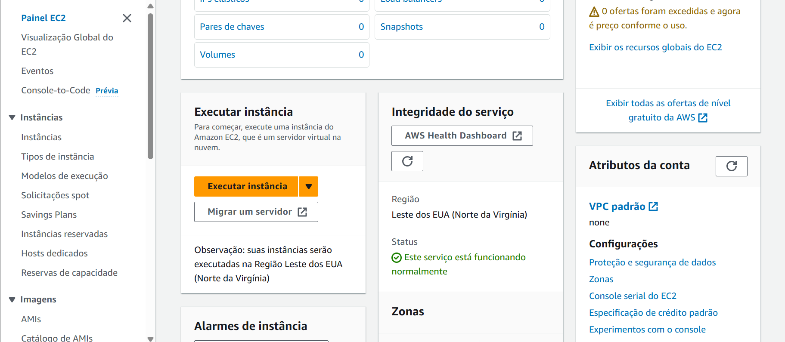
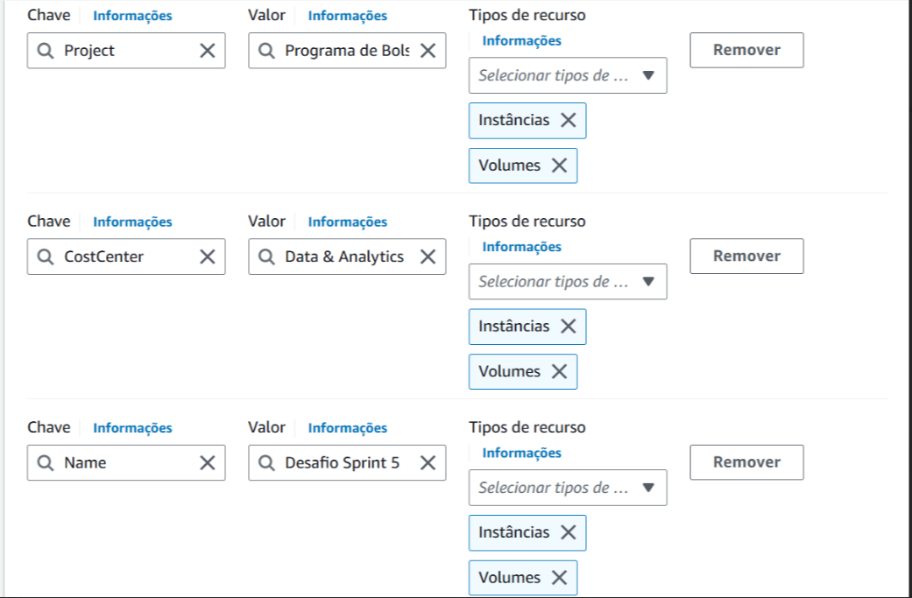
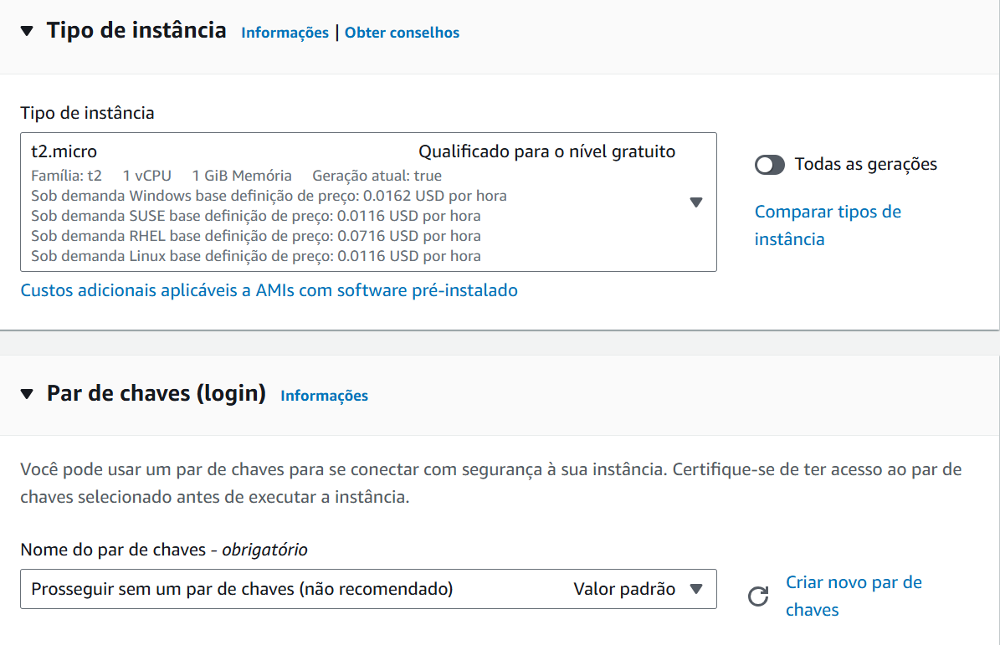
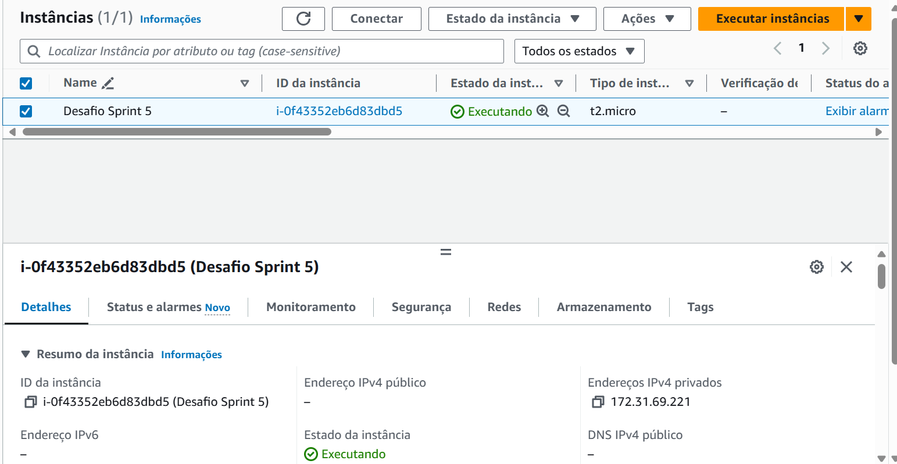
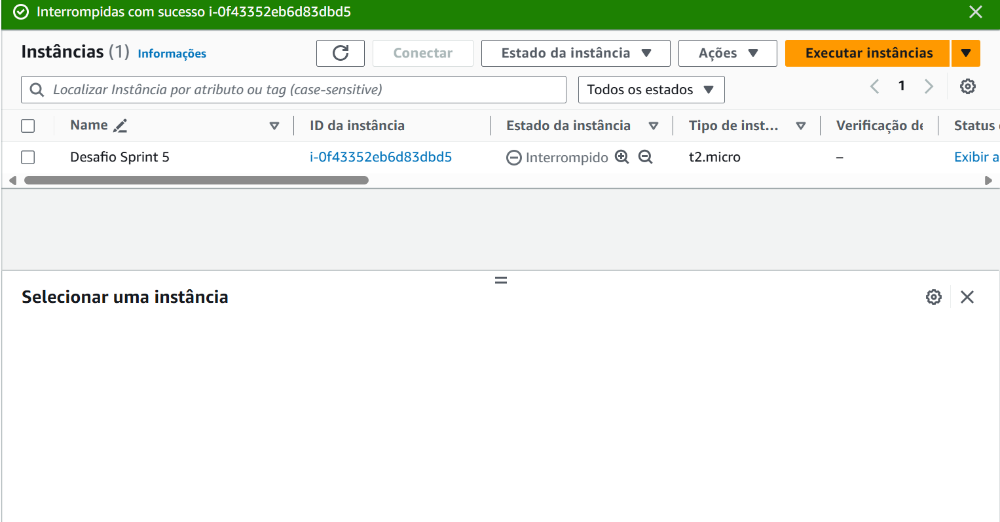

# Através da função S3 Select crie pelo menos uma consulta nos seus srquivos que utilize:

Uma cláusula que filtra dados usados ao menos dois operadores lógicos
  - Dois operadores lógicos    ----> "AND", "OR"
  - Duas funções de agregação  ----> "COUNT" "SUM"
  - Uma função condicional     ----> "CASE", COALESCE
  - Uma função de Conversão    ----> "FLOAT"
  - Uma função de data         ----> "UTCNOW" 
  - uma função de String       ----> "UPPER"   

## Funções usadas

- Função de data, agregação, conversão, operadores lógicos
```
SELECT UTCNOW(), 
                          SUM(CAST(s.Contagem_Municipios as FLOAT)),
                          COUNT(*)
                          FROM s3object s
                   WHERE (s.Contagem_Municipios > '2' AND s.Contagem_Municipios < '8' OR s.Reserva_da_Biosfera = 1);           				
```
- Função de string e condicional
```
SELECT UPPER(Bioma_declarado), Contagem_UFs,
                          COALESCE(Bioma_declarado = 'Cerrado'), 
                          CASE WHEN CAST(Contagem_UFs as INT) = 1 THEN 'group1' 
                                            WHEN CAST(Contagem_UFs as INT) = 2 THEN 'group2' 
                                            WHEN CAST(Contagem_UFs as INT) = 3 THEN 'group3' 
                                            ELSE 'group4' END FROM S3Object;		
```


# Desenvolvimento do Desafio

Primeiro limpei e organizei o dataset para poder passar pela consulta s3 select. 


## Credenciais AWS

```
!pip install boto3
```

## Importando bibliotecas

```
import pandas as pd
import numpy as np
import boto3
```

## Configurando credenciais, sessão, bucket e fazendo upload do arquivo
```
import boto3
from botocore.exceptions import NoCredentialsError, PartialCredentialsError

# Configurar credenciais
aws_access_key_id = 
aws_secret_access_key = 
aws_session_token = 

# Criar uma sessão boto3
session = boto3.Session(
    aws_access_key_id=aws_access_key_id,
    aws_secret_access_key=aws_secret_access_key,
    aws_session_token=aws_session_token
)

# Criar um cliente S3
s3 = session.client('s3')

# Nome do bucket e chave S3
bucket_name = 'desafiopamela'
s3_key = 'CNUC_2024_02_limpo.csv'
file_path = 'CNUC_2024_02_limpo.csv'

try:
    # Criar um novo bucket
    s3.create_bucket(Bucket=bucket_name)
    print(f"Bucket {bucket_name} criado com sucesso.")

    # Fazer o upload do arquivo para o bucket
    s3.upload_file(file_path, bucket_name, s3_key)
    print(f"Arquivo {s3_key} carregado com sucesso no bucket {bucket_name}.")

except NoCredentialsError:
    print("Erro: Credenciais não encontradas.")
except PartialCredentialsError:
    print("Erro: Credenciais incompletas.")
except Exception as e:
    print(f"Erro: {e}")
```

## Código para executar as consultas
```
# Criar uma sessão boto3
session = boto3.Session(
    aws_access_key_id=aws_access_key_id,
    aws_secret_access_key=aws_secret_access_key,
    aws_session_token=aws_session_token  # Opcional, para credenciais temporárias
)

# Criar um cliente S3
s3 = session.client('s3')
bucket_name = 'desafiopamela'
s3_key = 'CNUC_2024_02_limpo.csv'

response = s3.select_object_content(
    Bucket=bucket_name,
    Key=s3_key,
    ExpressionType='SQL',
    Expression= """SELECT UPPER(Bioma_declarado), Contagem_UFs,
                          COALESCE(Bioma_declarado = 'Cerrado'),
                          CASE WHEN CAST(Contagem_UFs as INT) = 1 THEN 'group1'
                                            WHEN CAST(Contagem_UFs as INT) = 2 THEN 'group2'
                                            WHEN CAST(Contagem_UFs as INT) = 3 THEN 'group3'
                                            ELSE 'group4' END FROM S3Object;
            """,
    InputSerialization={'CSV': {"FileHeaderInfo": "USE", "FieldDelimiter": ";"}},
    OutputSerialization={'CSV': {}},
)

# Eu usei esse codigo para fazer testes
# for event in response['Payload']:
#     if 'Records' in event:
#         print(event['Records']['Payload'].decode('utf-8', 'ignore'))
#     elif 'Stats' in event:
#         print(event['Stats'])

# Criar um arquivo para salvar a saída
with open('cerrado_true_group_UF.py', 'w') as f:
    for event in response['Payload']:
        if 'Records' in event:
            f.write(event['Records']['Payload'].decode('utf-8', 'ignore') + '\n')
        elif 'Stats' in event:
            f.write(str(event['Stats']) + '\n')
```


# Criação da instância












