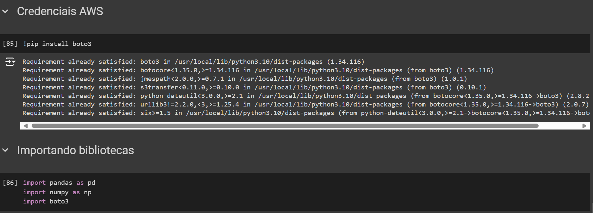
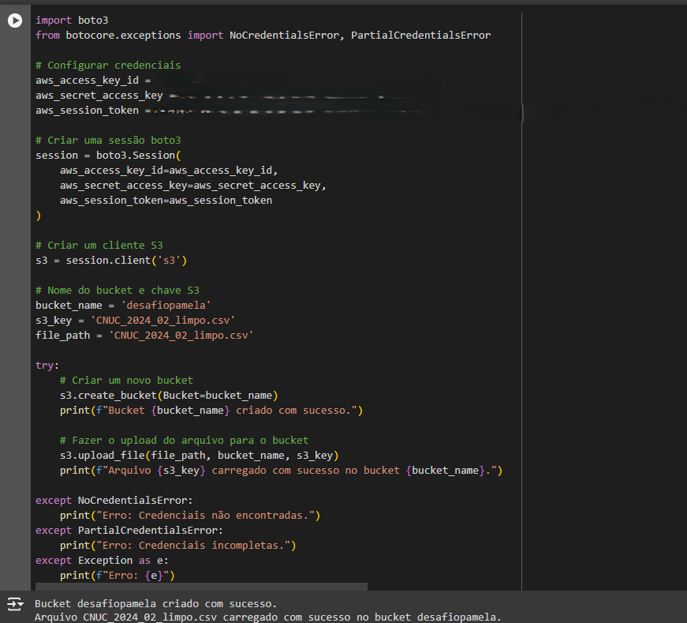
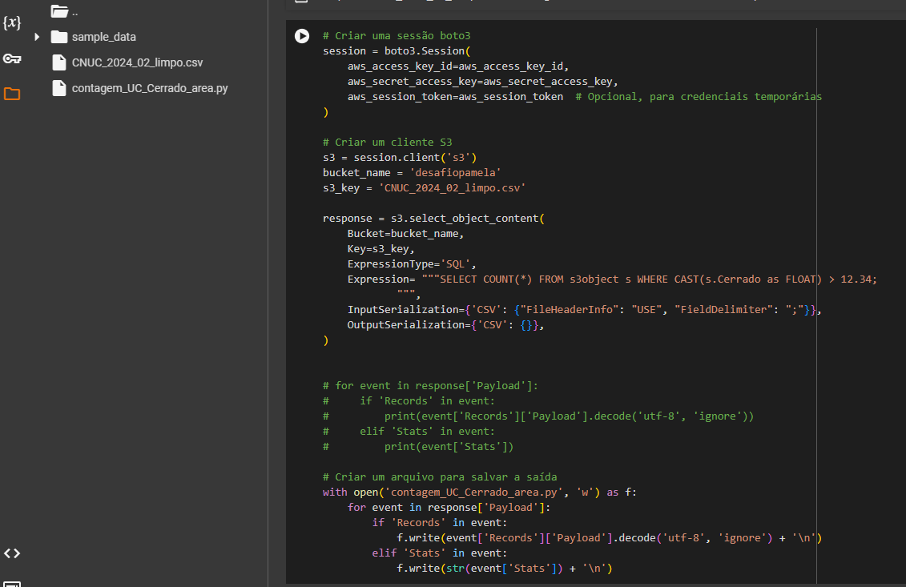
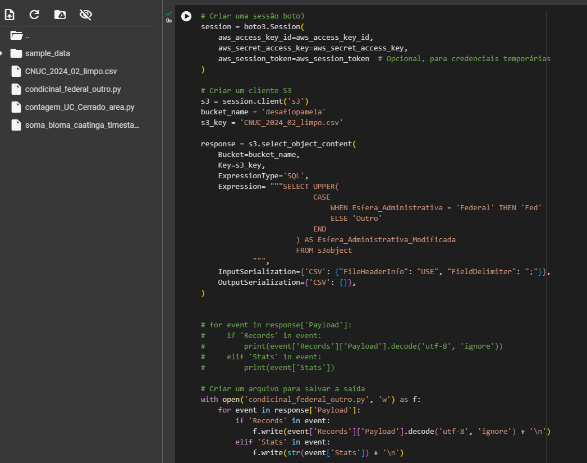
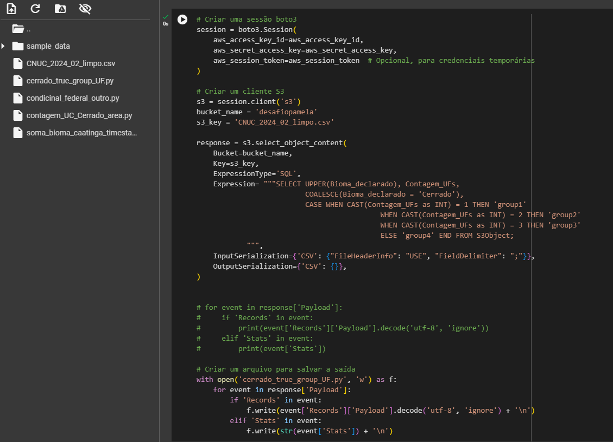
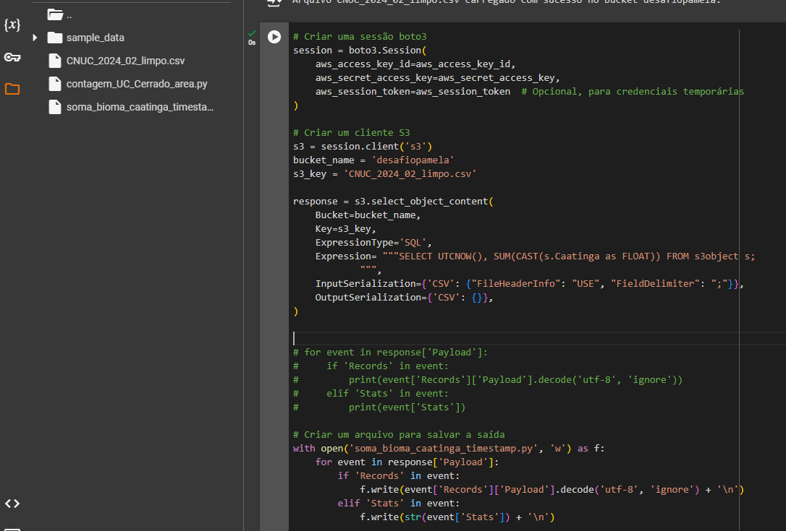

# Evidências do desafio da sprint 5

Optei por usar a sdk do boto3 para realizar o desafio e instalei as dependências e bibliotecas

Configuei as credenciais e iniciei uma seção, crei um bucket e fiz o upload do arquivo para a aws

Criei um código para executar a consulta em SQL usando S3 Select

- Função de agregação

 

- Função string e condicional

 

- Função string e duas condicionais

 

- Função agregação, data e conversão

 

