# Desenvolvimento do desafio

# Índice

- [Introdução](#introdução)
  - [Criação das pastas](#criação-das-pastas)
  - [Requirements](#requirements)
  - [Arquivo Dockerfile e docker compose](#arquivo-dockerfile-e-docker-compose)
  - [Confirmando build a criação container e da imagem](#confirmando-build-a-criação-container-e-da-imagem)
  - [Confirmando a criação do bucket e a carga dos dados](#confirmando-a-criação-do-bucket-e-a-carga-dos-dados)

# Introdução

Apesar de preferir mais o Colab ou Jupiter para executar arquivos csv, para esse desafio preferi utilizar o vscode pois ele suporta todas as tarefas como execução de containers.

## Criação das pastas

Fiz uma pasta com os comandos para a ingestão dos dados para a AWS e criei 3 arquivos para melhor gerir o código. E as credenciais da AWS e os nomes dos containers e imagem coloquei em um arquivo .env. Fiz um arquivo .dockerignore para que as credenciais não sejam carregadas para o volume.

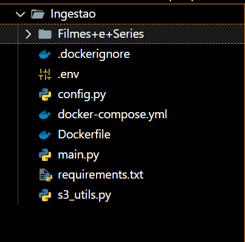

- config.py  

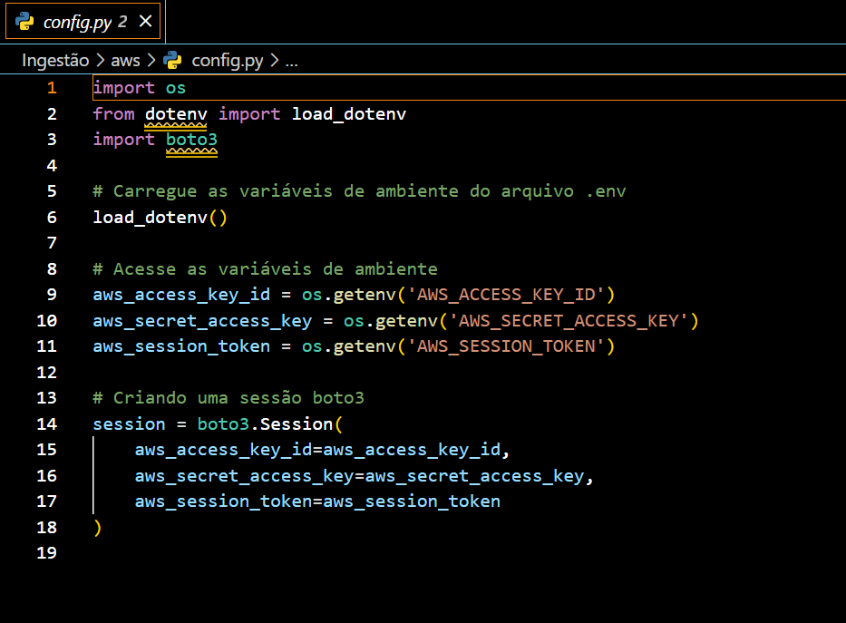

- s3_utils.py

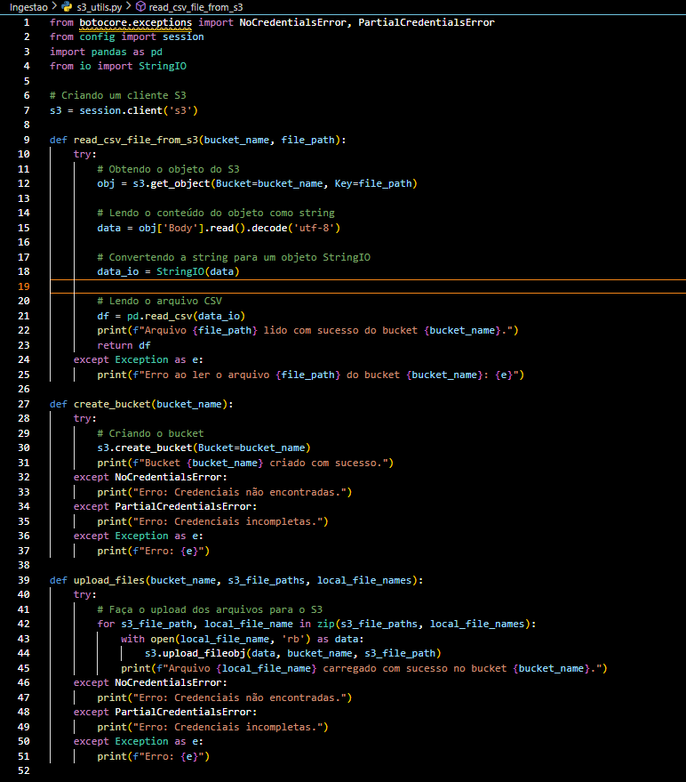

- main.py

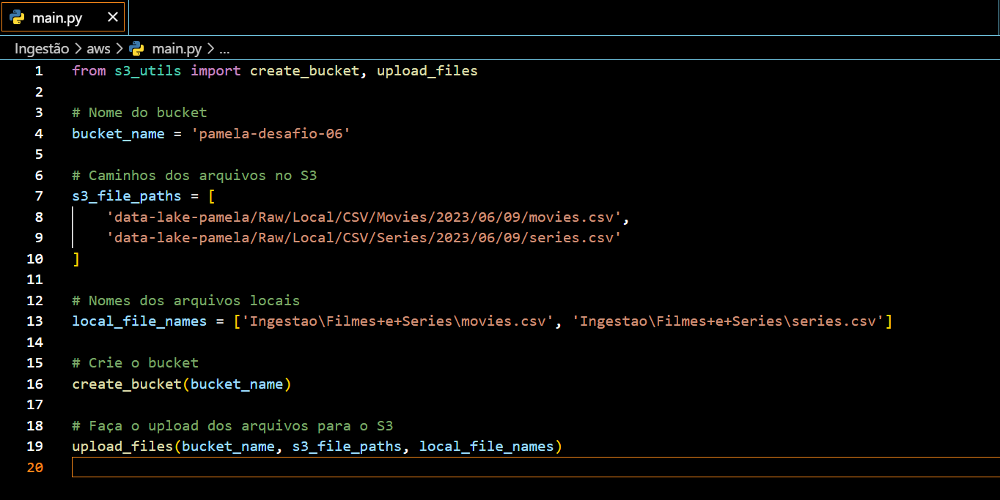

## Requirements

Fiz um arquivo chamado requirements.txt para poder baixar as bibliotecas quando o Docker for executado

- requirements.txt

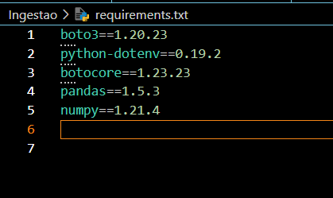

## Arquivo Dockerfile e docker compose

- Dockerfile

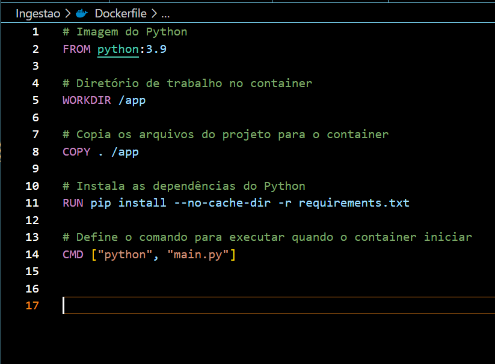

- Docker-Compose

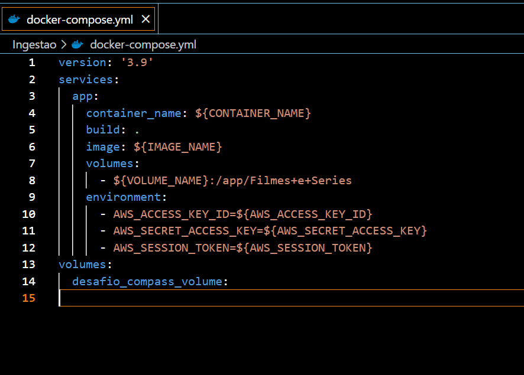

## Confirmando build a criação container e da imagem

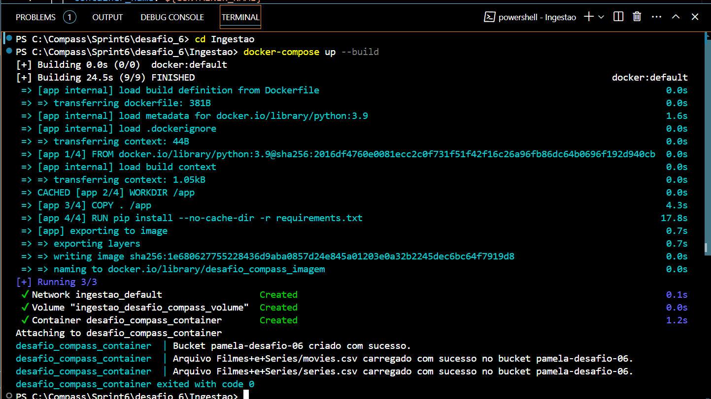

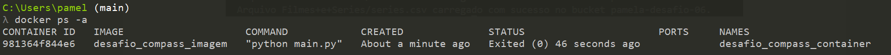

## Confirmando a criação do bucket e a carga dos dados:

- movies.csv

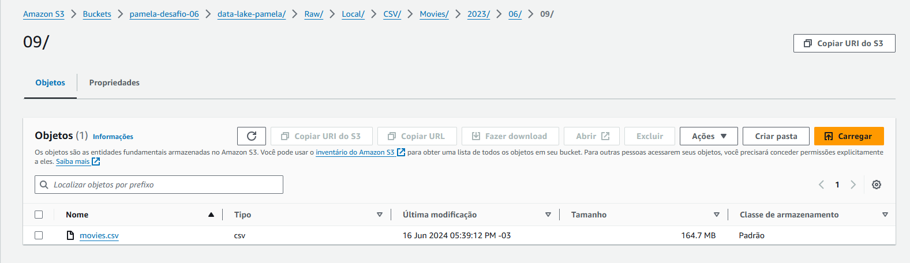

- series.csv

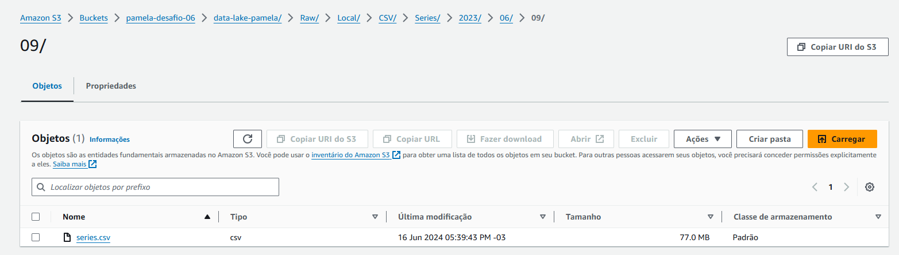

