# Evidências Desafio 07

Claro! Aqui está o índice clicável para o seu arquivo Markdown, com os códigos formatados como comentários:

## Índice

1. [Credenciais da API](#credenciais-da-api)
    - [Criando o segredo no Secrets Manager](#criando-o-segredo-no-secrets-manager)
    - [Criando uma role para o uso do segredo](#criando-uma-role-para-o-uso-do-segredo)
    - [Criando uma Role para a Política](#criando-uma-role-para-a-política)
2. [Criando a Função Lambda](#criando-a-função-lambda)
    - [Criando primeiro a camada](#criando-primeiro-a-camada)
    - [Criando a camada](#criando-a-camada)
    - [Criando a função](#criando-a-função)

## Introdução

Nesse desafio, primeiro tentei usar o Secrets Manager para poder usar as credenciais da API, achei fácil de usar e cadastrar. Porém tive dificuldade com a criação da camada. Tentei fazer de várias maneiras até que por fim consegui. Por isso, e por questão de tempo e praticidade também utilizei as variáveis de ambiente da própria função lambda. Até por que eu precisei fazer algumas modificações no código para poder rodar na lambda.

## Credenciais da API

Para esse desafio decidi usar uma abordagem diferente para as credenciais, decidi usar o Secrets Manager para armazenar as credenciais da API da TMDB

### Criando o segredo no Secrets Manager

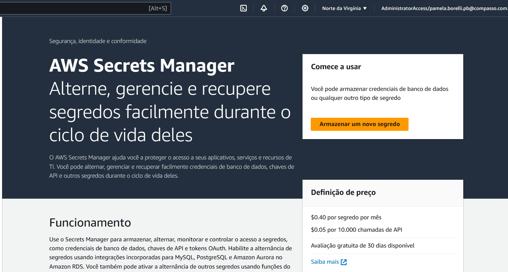

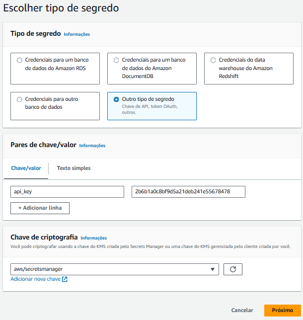
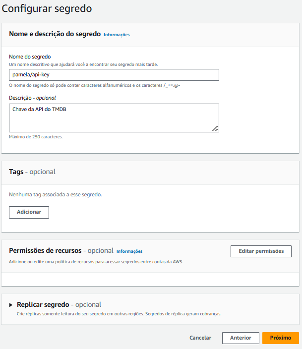
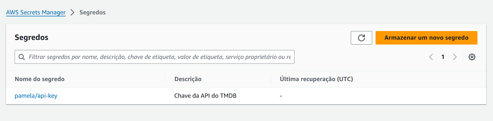

### Criando uma role para o uso do segredo
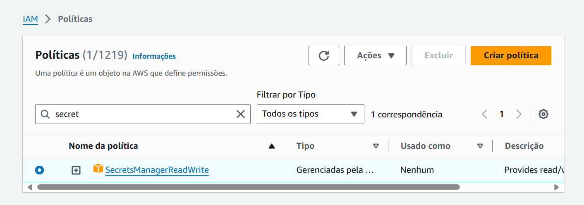
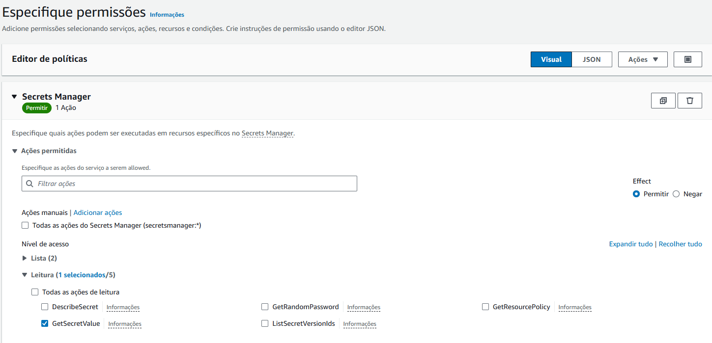
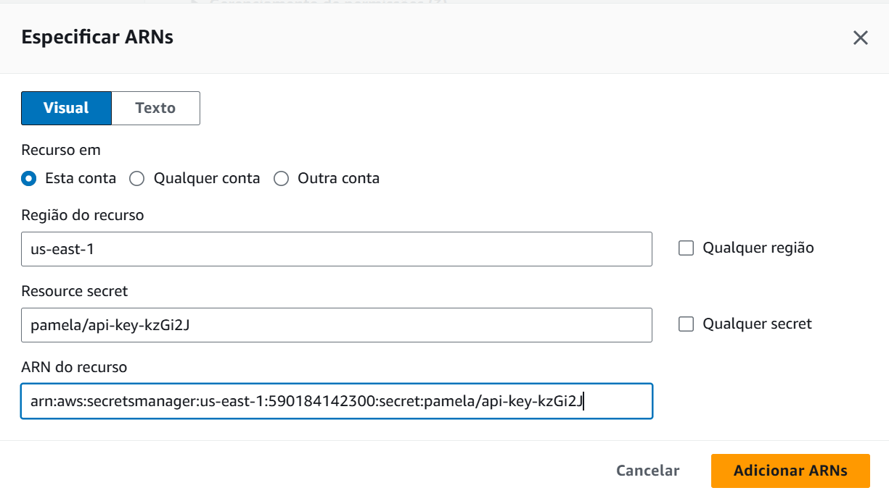
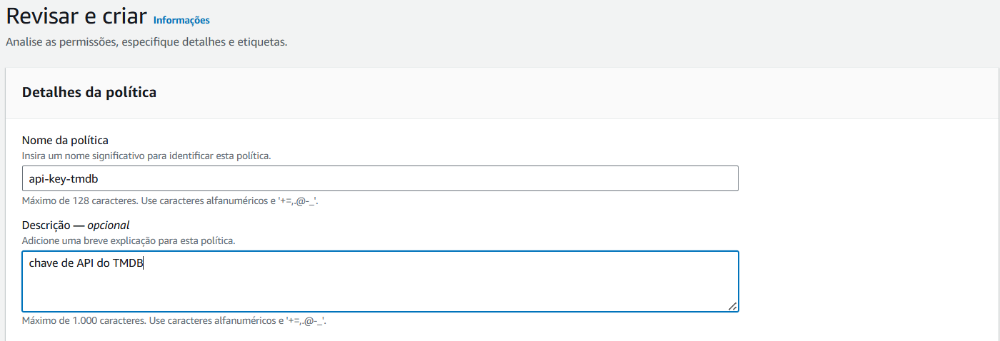
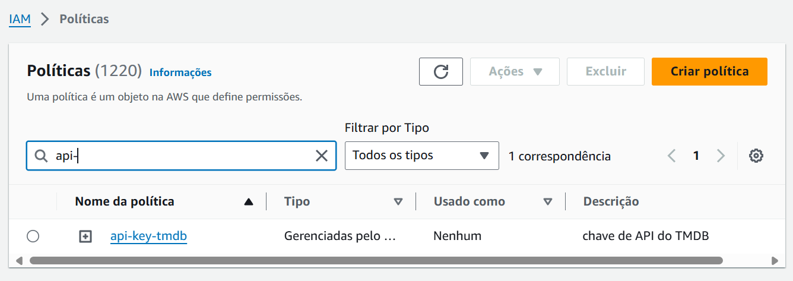

### Criando uma Role para a Política
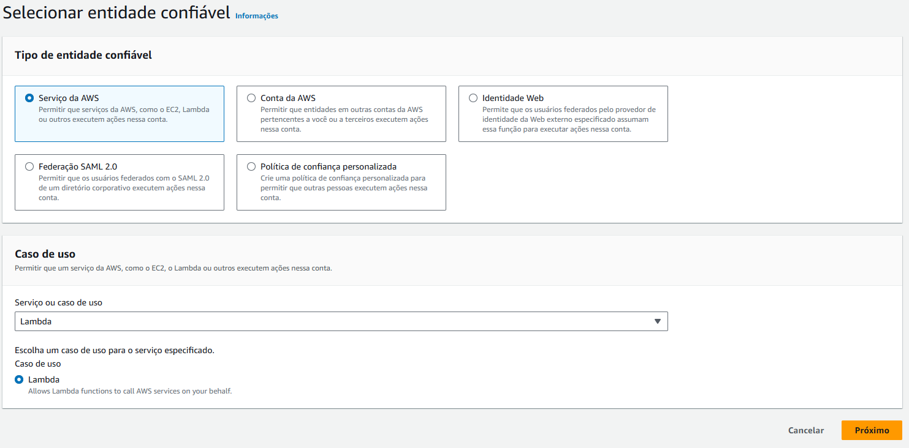
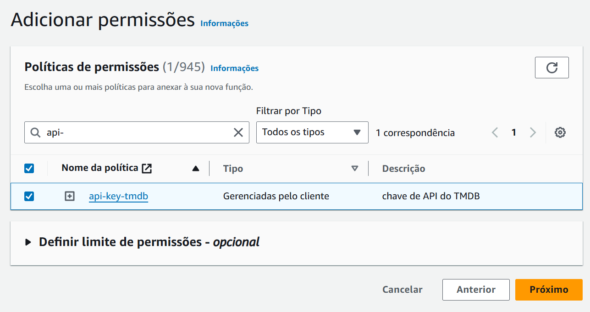
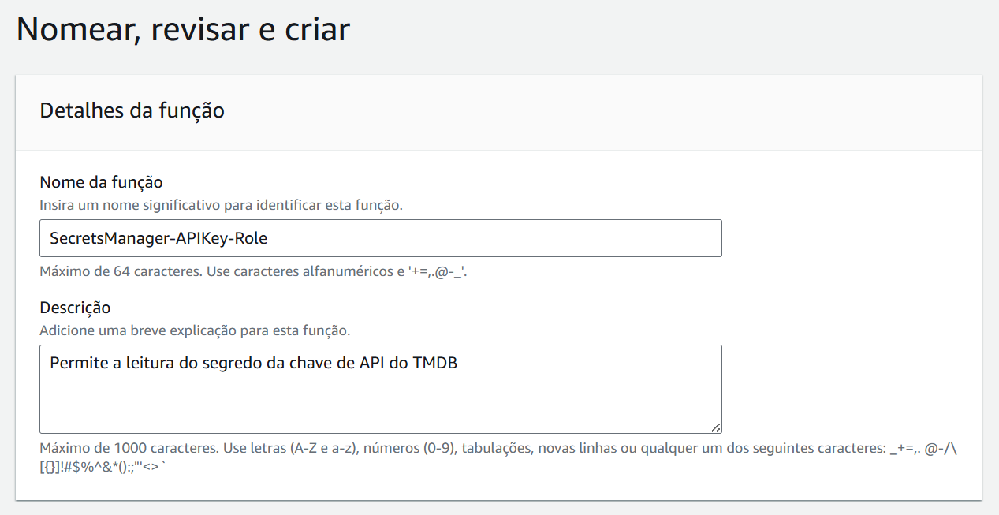
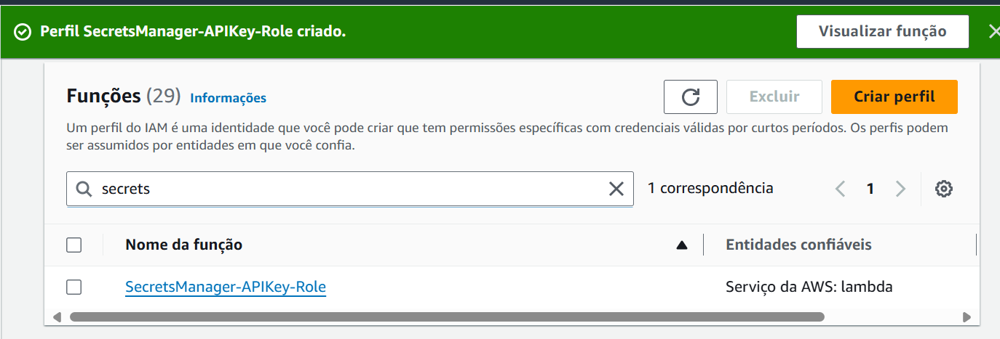

## Criando a Função Lambda

### Criando primeiro a camada

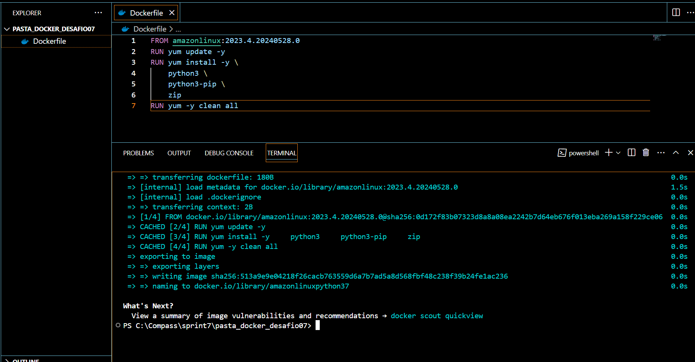

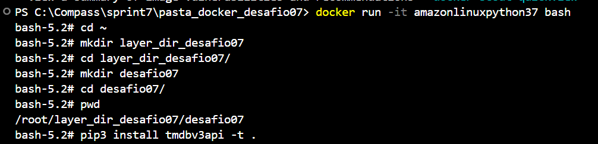

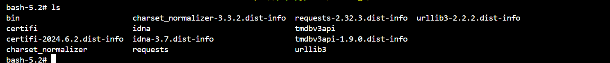

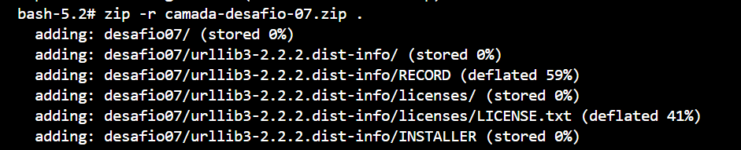

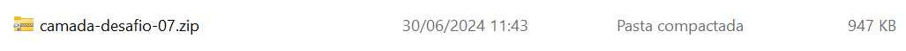

### Criando a camada
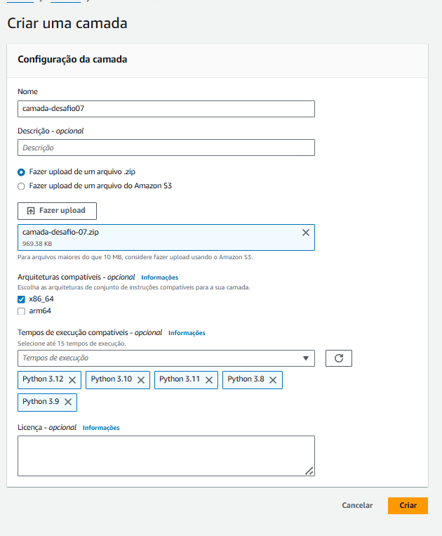
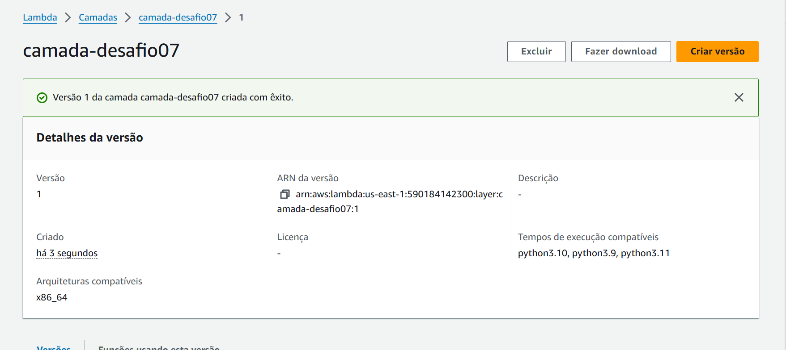

## Criando a função
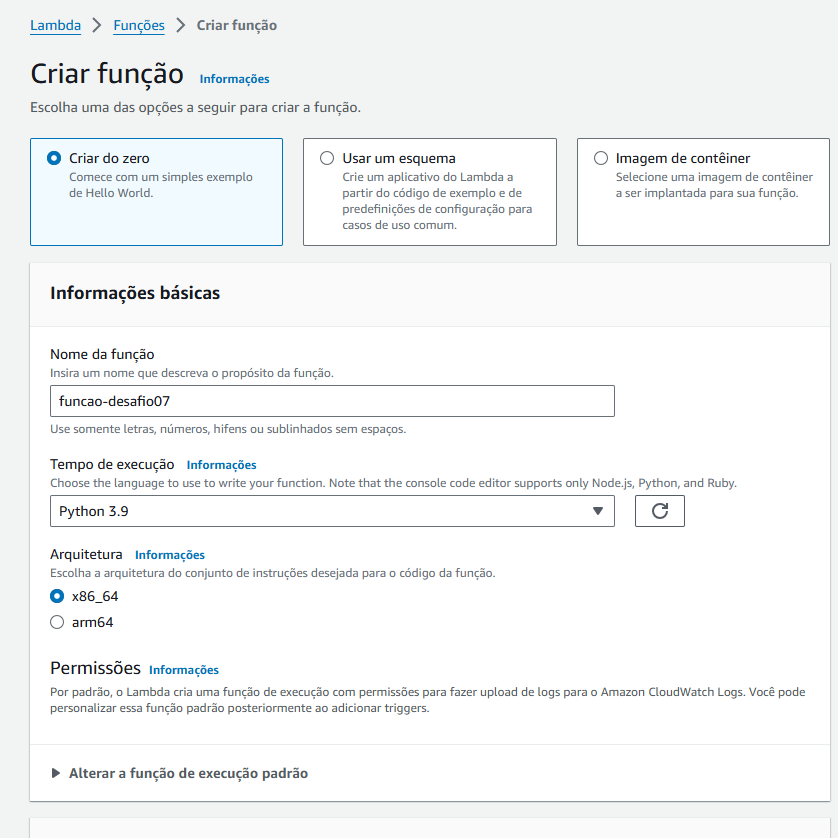
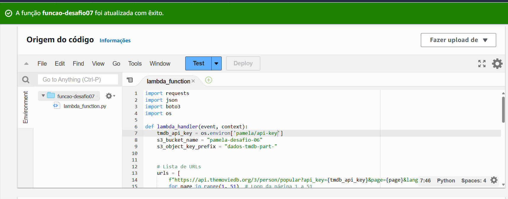
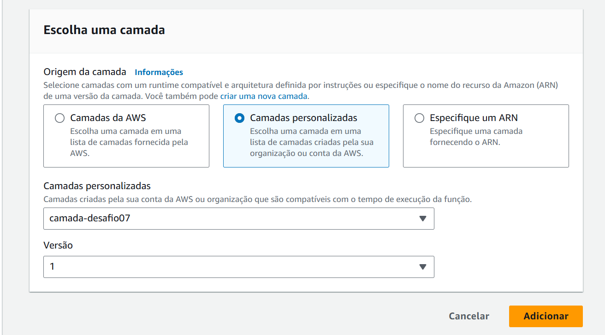
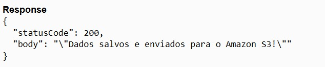
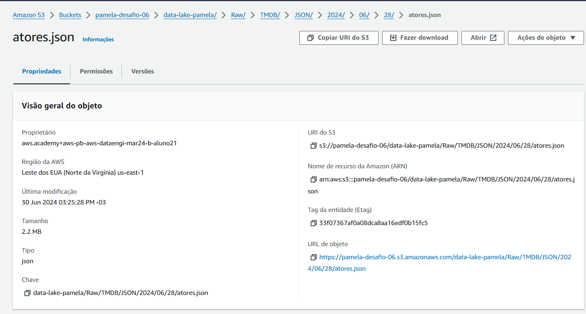

