# Exercício JavaWordCount

## Índice
1. [Fazendo o pull da imagem](#fazendo-o-pull-da-imagem)
2. [Criando o container](#criando-o-container)
3. [Abrindo o Spark no shell do Linux](#abrindo-o-spark-no-shell-do-linux)
4. [Copiando o arquivo README.md do meu repositório](#copiando-o-arquivo-readme.md-do-meu-repositório)
5. [Rodando o comando para leitura do arquivo](#rodando-o-comando-para-leitura-do-arquivo)
6. [Contando as palavras](#contando-as-palavras)
7. [Parando o container](#parando-o-container)

## Fazendo o pull da imagem 

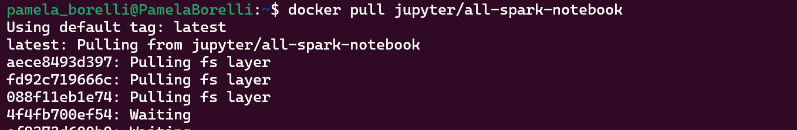
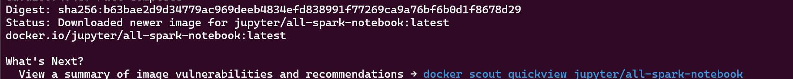
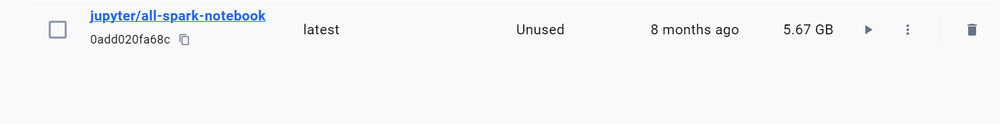

## Criando o container

- Para esssa parte usei o docker desktop

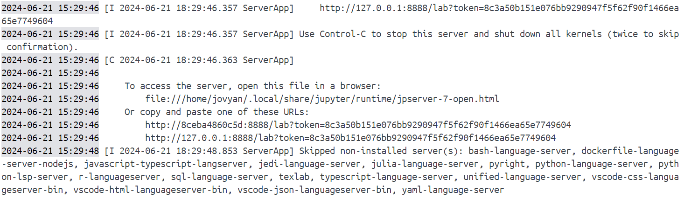
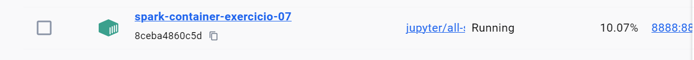

## Abrindo o Spark no shell do linux
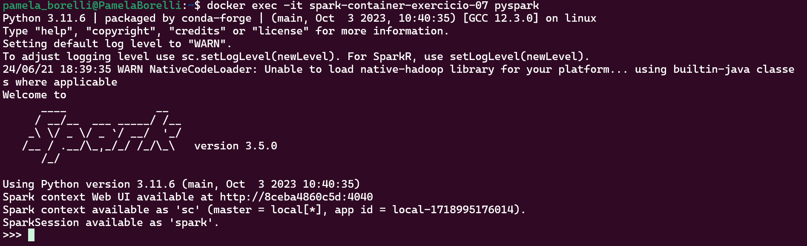

## Copiando o arquivo README.md do meu repositório
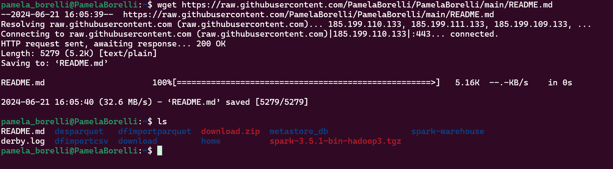

- salvei o arquivo no nano

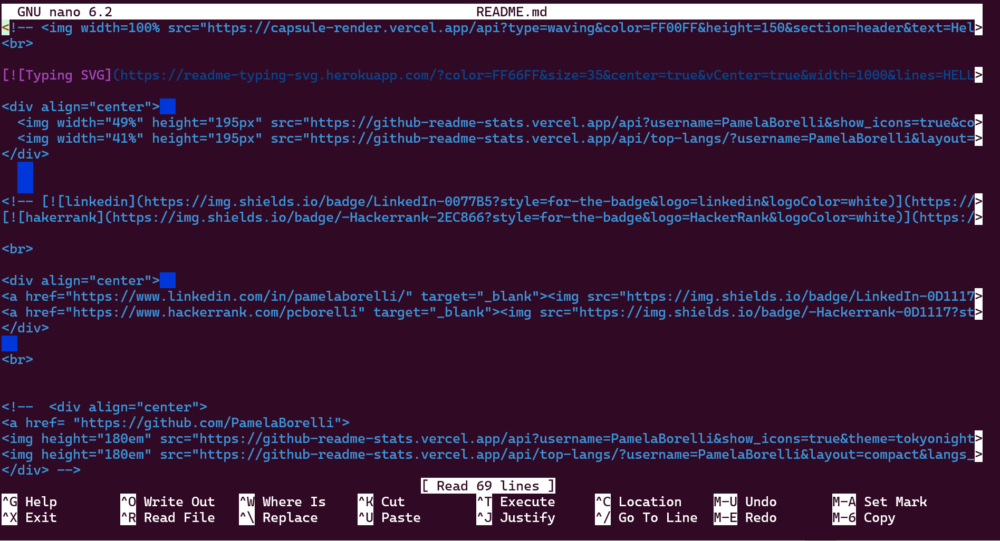

## rodando o comando para leitura do arquivo
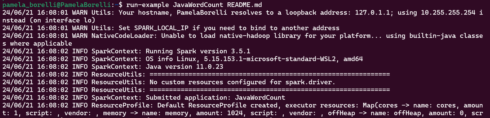

## - contando as palavras
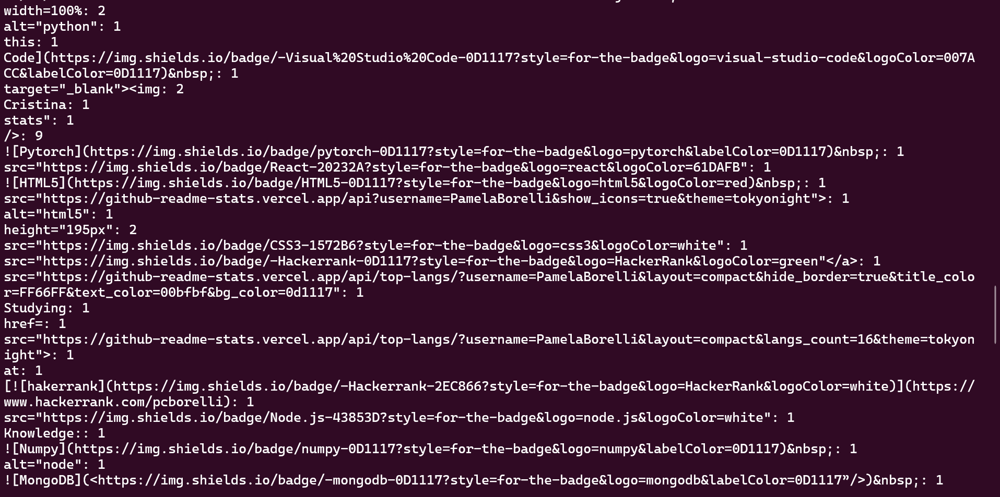

## parando o container
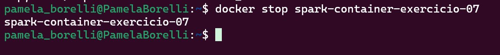

