# Sprint 08 - Exercícios Spark Batck

Não tive dificuldades em desenvolver o exercício, eu também fiz um curso em paralelo na Udemy.

[Geração de massa de dados](#1---geração-e-massa-de-dados)

- [Etapa 1](#etapa-1)
- [Etapa 2](#etapa-2)
- [Etapa 3](#etapa-3)

[Geração de massa de dados](#2--apache-spark)

- [Etapa 2](#etapa-2-apache)
- [Etapa 3](#etapa-3-apache)
- [Etapa 4](#etapa-4-apache)
- [Etapa 5](#etapa-5-apache)
- [Etapa 6](#etapa-6-apache)
- [Etapa 7](#etapa-7-apache)
- [Etapa 8](#etapa-8-apache)
- [Etapa 9](#etapa-9-apache)
- [Etapa 10](#etapa-10-apache)

## 1 - Geração e massa de dados

### Etapa 1

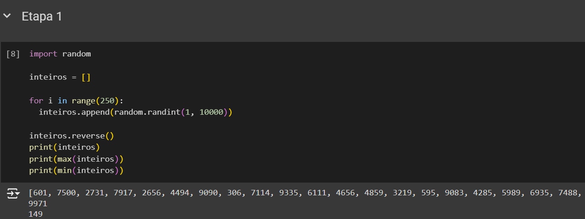

### Etapa 2

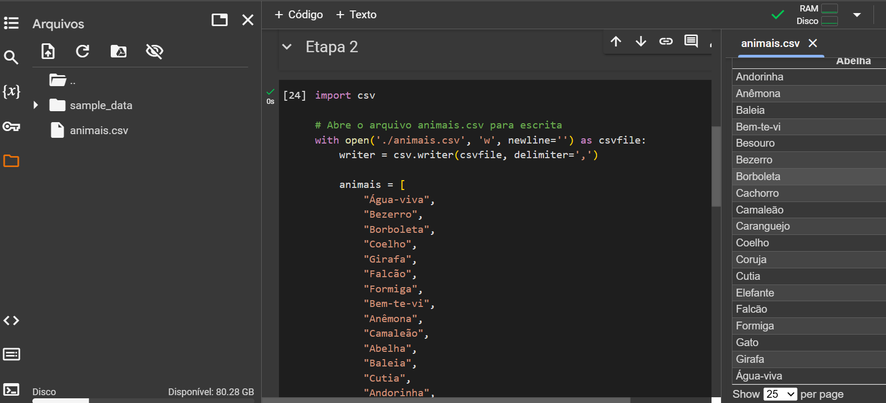

### Etapa 3
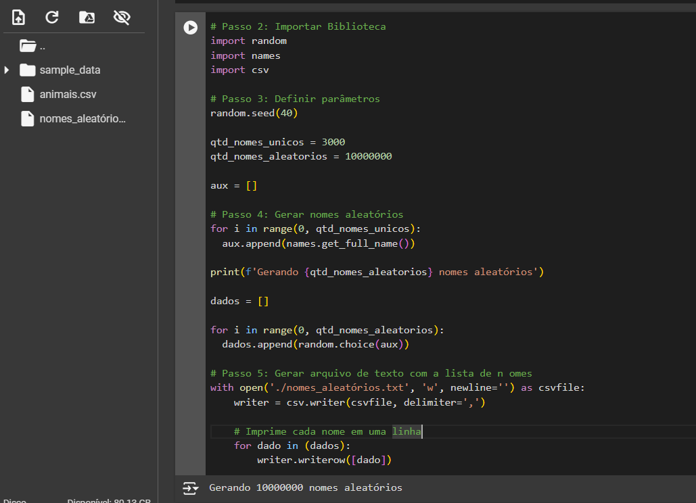
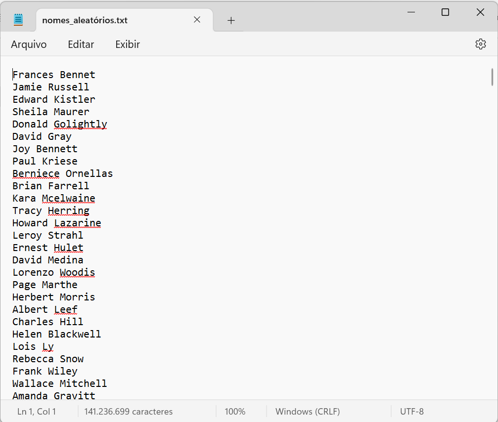

## 2- Apache Spark
### Etapa 2
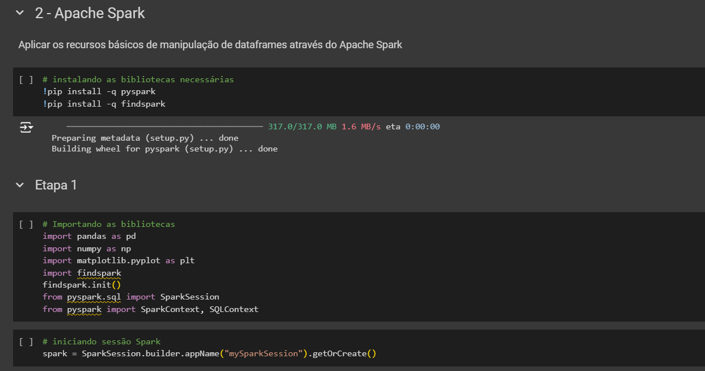

### Etapa 2
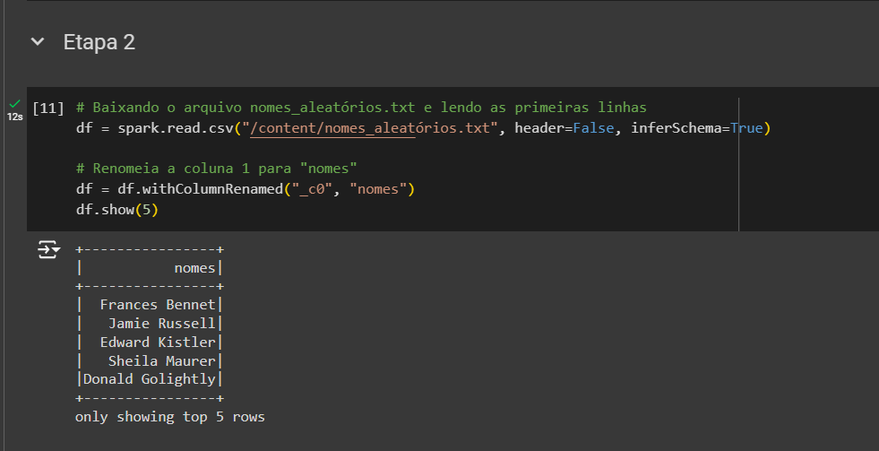

### Etapa 3
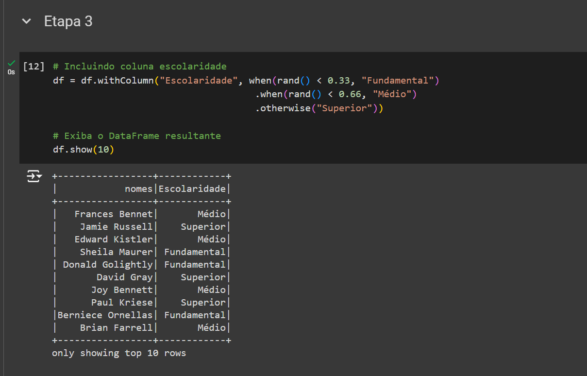

### Etapa 4

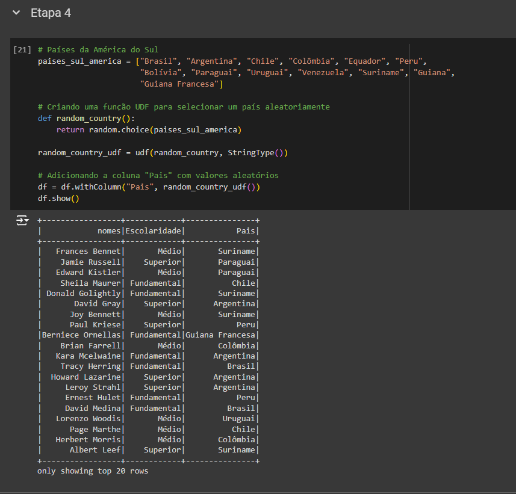

### Etapa 5

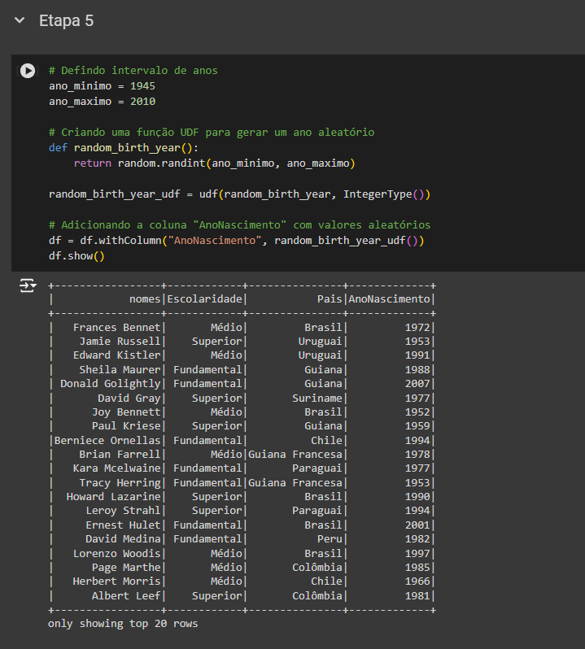

### Etapa 6
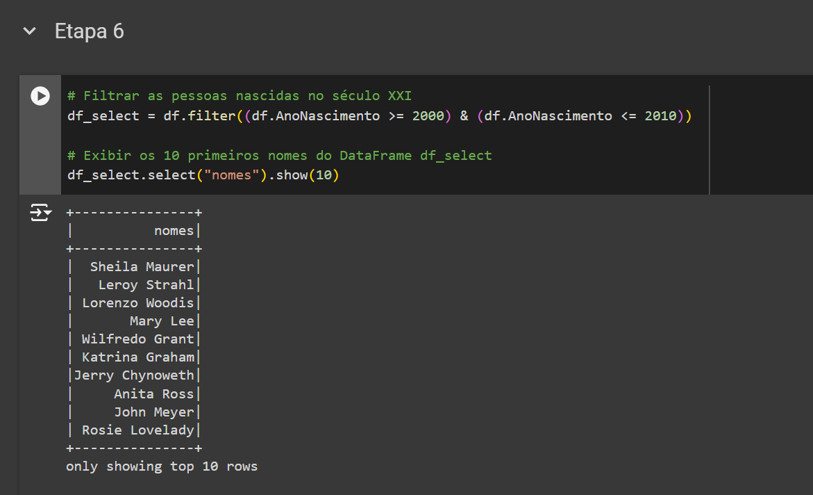

### Etapa 7
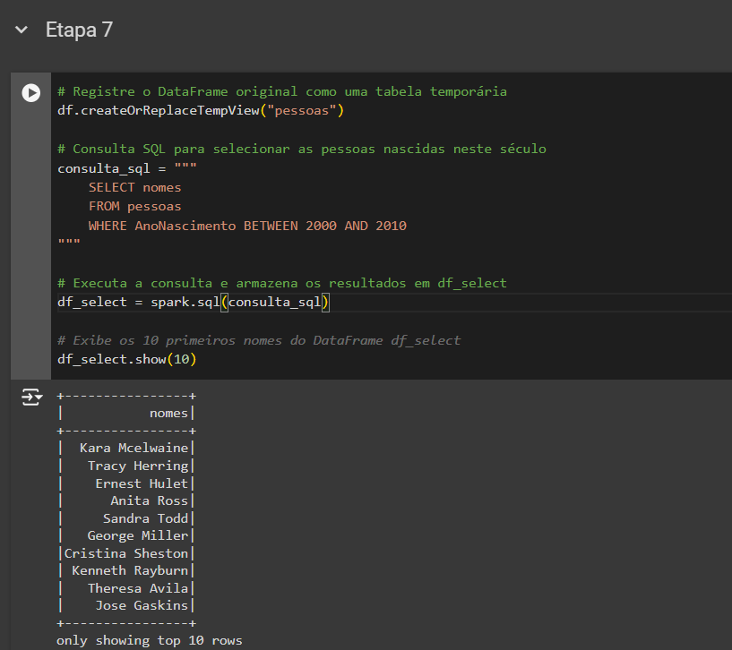

### Etapa 8
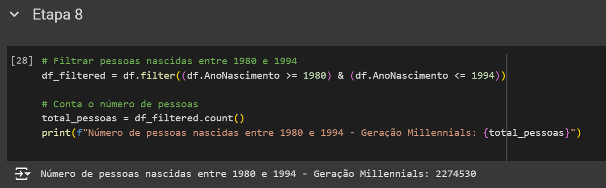

### Etapa 9
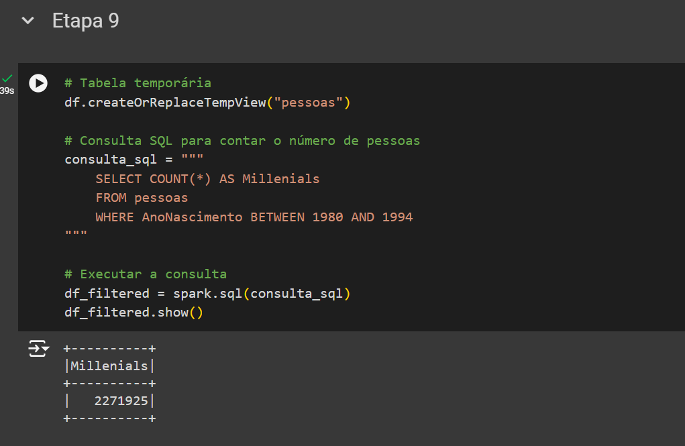

### Etapa 10

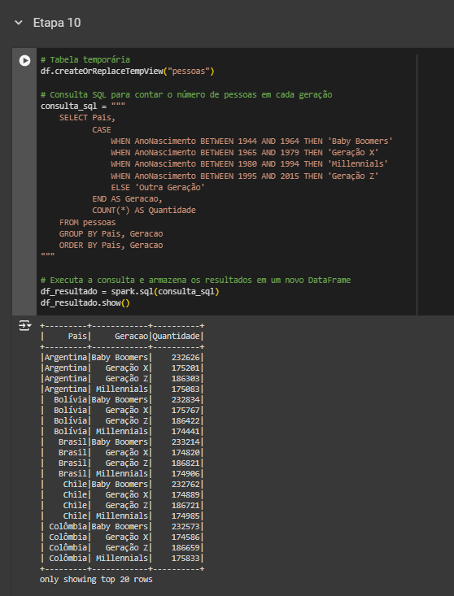

