# Desafio Sprint 9

1. [Introdução](#introdução)

1. [Revisão das tabelas criadas](#revisão-das-tabelas-criadas)

2. [Rodando o job](#rodando-o-job)

    - [Script para fazer a camada Refined](#script-para-fazer-a-camada-refined)

3. [Crawler tabela refined](#crawler-tabela-refined)

4. [Criação do script para modelagem dos dados e criação das views](#criação-do-script-para-modelagem-dos-dados-e-criação-das-views)

    - [diagrama](#diagrama-das-tabelas-e-as-dimensôes)

5. [Tabelas](#)
    - [artistas](#tabelas-artistas)
    - [filme](#tabelas-filme)
    - [categoriaidade](#tabelas-categoriaidade)
    - [personagem](#tabelas-personagem)
    - [genero](#tabelas-genero)
    - [filmegenero](#tabelas-filmegenero)


6. [Dimensões](#dimensões)
    - [Fato Filme](#fatofilme)
    - [Dimensão Genero](#dimensão-genero)
    - [Dimensão filme](#dimensão-elenco-personagem)
    - [Dimensão Elenco Personagem](#dimensão-elenco-personagem)

7. [Views](#views)


## Introdução

Para essa sprint precisei terminar de fazer algumas limpezas que não havia conseguido na sprint passada. 

Depois dos dados limpos, optei por fazer um dataset consolidado, pois nesse caso são poucos dados e tabelas. A partir desse ponto decidi como separar a tabela consolidada em dimensões.


 Depois mais a diante eu criei algumas views. Mas primeiro relembrei as minhas perguntas:

- Qual é a tendência das notas dos filmes e séries em relação à duração ao longo da década?
- Na década análisada, qual foi a média de nota do gênero?
- Qual ator e atriz mais bem avaliados até a coleta dos dados?
- Qual ator e qual atriz foi mais requisitado(a) nessa década, e qual a média das notas que das produções que ele(a) atuou?
- Podemos levantar quais atores e atrizes trabalharam tanto em séries quanto em filmes, e quantos trabalharam exclusivamente em filmes e exclusivamente em séries.


Como tive muita dificuldade na sprint passada fiquei com receio de não conseguir trabalhar com todos os dados, a minha intenção era usar o dataframe com series e filmes, e depois tbem trababar com duração dos mesmos e a coluna de profissão,, além disso diminui os dados somente para filmes de 2000 até agora. 

Acabei retirando essas informações da análise pelo motivo já explicado. Agora que entendi como o Glue funciona acho que não tinha necessidade de tirar as informações, mas ainda sim acho que foi uma boa decisão, melhor apresentar algo menor e bem feito do que algo grande e mal feito.

Então com base nos dados que eu refinei as perguntas adaptadas daquelas iniciais seriam:

- Qual a quantidade de filmes realizados em cada ano? e Qual a média de nota em cada ano?
- Quais são os artistas mais bem avaliados dentro de sua categoria de idade, seu filme mais bem avaliado e a nota?
- Qual a quantidade de filmes cada categoria de idade participou, quantos artistas envolvidos e a media de notas dos filmes em relação aos artistas?
- Para os artistas, qual categoria ele pertence, qual sua avaliação, quantos filmes ele atuou e a média de notas dos filmes que participou?
- Qual a quantidade de filmes nas categorias 'War' e 'Crime' e qual a media de notas dessas categorias?
- Quais são os top 5 dentro da categoria 'War' e 'Crime', suas notas, qual artista mais bem avaliado?

Tentei manter o máximo que pude manter as perguntas que havia selecionado, e tentei encontrar novas perguntas com base no que encontrei.


## revisão das tabelas criadas

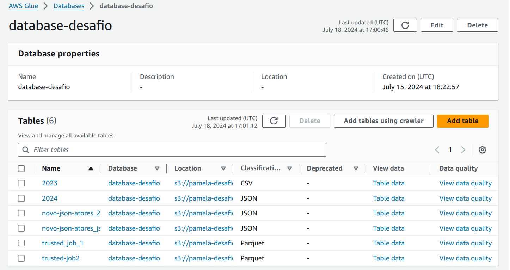

## Rodando o job
### Script para fazer a camada Refined
Como havia mencionado na sprint anterior, queria particionar o código de acordo com a categoria de idade. E por algum motivo não consegui criar o a tabela direto no script, vou fazer um crawler para a tabela refined

 
```
import sys
from awsglue.transforms import *
from awsglue.utils import getResolvedOptions
from pyspark.context import SparkContext
from awsglue.context import GlueContext
from awsglue.job import Job
from pyspark.sql.functions import col, when, split, monotonically_increasing_id
from awsglue.dynamicframe import DynamicFrame

# Inicializando as variáveis de entrada
args = getResolvedOptions(sys.argv, ['JOB_NAME'])

# Configurando o Spark e GlueContext
sc = SparkContext()
glueContext = GlueContext(sc)
spark = glueContext.spark_session
job = Job(glueContext)
job.init(args['JOB_NAME'], args)

# Carregue o DataFrame
df_artistas = glueContext.create_dynamic_frame.from_catalog(database="database-desafio", table_name="trusted_job_2").toDF()
df = glueContext.create_dynamic_frame.from_catalog(database="database-desafio", table_name="trusted-job-1").toDF()

# Casting do atributo id e gender para ficar no mesmo esquema que os DFs anteriores
df = df.withColumn('notamedia', col('notamedia').cast('int'))
df = df.withColumn('anonascimento', col('anonascimento').cast('int'))
df = df.withColumn('anolancamento', col('anolancamento').cast('int'))

df.printSchema()

# Eliminando colunas
df = df.drop("partition_0", "partition_1")

# Renomear colunas específicas
df = df.withColumnRenamed("genero", "generofilme").withColumnRenamed('id', "idfilme")
df.show(5)

# Selecionando as linhas com pelo menos um dos valores "war" ou "crime"
df = df.filter((col("generofilme").like("%War%") | col("generofilme").like("%Crime%")) & (col("anonascimento") >= 1944))

# Modificando o valor da coluna 'generoArtista' para valores numéricos
df = df.withColumn("generoartista", when(col("generoartista") == "actor", 2).otherwise(1))
df.show(5)

# Criando uma coluna para idade
df_filtered = df.withColumn("idadeartista", 2024 - col("anonascimento"))

# Criando a coluna de categoria de idade
df_filtered = df_filtered.withColumn("categoriaIdade",
                                     when((col("idadeartista") >= 1) & (col("idadeartista") <= 20), "juvenil")
                                     .when((col("idadeartista") >= 21) & (col("idadeartista") <= 40), "adultos")
                                     .when((col("idadeartista") >= 41) & (col("idadeartista") <= 60), "maduros")
                                     .otherwise("idosos"))

# Exiba o DataFrame resultante
df_filtered.show(5)

# Dividindo a coluna "generofilme" em três colunas
df_split = df_filtered.withColumn("genero_lista", split(col("generofilme"), ","))

# Extraindo elementos da coluna de array
df_split = df_split.withColumn("generofilme1", col("genero_lista").getItem(0)) \
                   .withColumn("generofilme2", col("genero_lista").getItem(1)) \
                   .withColumn("generofilme3", col("genero_lista").getItem(2))

# Substitui os valores nulos nas colunas generofilme2 e generofilme3
df_split = df_split.withColumn("generofilme2", when(col("generofilme2").isNull(), "sem informacao").otherwise(col("generofilme2"))) \
                   .withColumn("generofilme3", when(col("generofilme3").isNull(), "sem informacao").otherwise(col("generofilme3")))

# Eliminando "generofilme" e "genero_lista"
df_split = df_split.drop("generofilme", "genero_lista")

# Exibindo o resultado
df_split.show(5)

# Inner join para ter os dados que quero
df_joined = df_split.join(df_artistas, df_split["nomeartista"] == df_artistas["nome"], "inner")

# Renomear colunas específicas
df_joined = df_joined.withColumnRenamed("id", "idartista") \
                     .withColumnRenamed("nome", "nomeartistaavaliacao") \
                     .withColumnRenamed("nomeOriginal", "nomeoriginalavaliacao") \
                     .withColumnRenamed("genero", "generoartistaavaliacao") \
                     .withColumnRenamed("avaliacao", "avaliacaoartista")

df_joined.show(5)

# Criando uma nova coluna "idpersonagem" com valores únicos
df_joined = df_joined.withColumn("idpersonagem", monotonically_increasing_id())

# Colocando as colunas na ordem desejada
df_ordenado = df_joined.select('idfilme',
                             'titulopincipal',
                             'titulooriginal',
                             'anolancamento',
                             'numerovotos',
                             'notamedia',
                             'generofilme1',
                             'generofilme2',
                             'generofilme3',
                             'nomeartista',
                             'generoartista',
                            'idpersonagem',
                             'personagem',
                             'idartista',
                             'avaliacaoartista',
                             'anonascimento',
                             'idadeartista',
                             'categoriaIdade',
                             'nomeartistaavaliacao',
                             'generoartistaavaliacao',
                             'nomeoriginalavaliacao')

# Exibindo o DataFrame resultante
df_ordenado.show(5)

# Salvando o DataFrame resultante de volta no S3
output_path = 's3://pamela-desafio-06/data-lake-pamela/Refined/job-refined/'
df_ordenado.write.mode('overwrite').parquet(output_path)

# # Registrando a tabela no Glue Catalog
# glueContext.create_dynamic_frame.from_catalog(database="database-desafio", table_name="refined")

# Criando a tabela no Glue Catalog com partição pela coluna 'categoriaIdade'
glueContext.write_dynamic_frame.from_options(
    frame=DynamicFrame.fromDF(df_ordenado, glueContext, "df_ordenado"),
    connection_type="s3",
    connection_options={"path": output_path, "partitionKeys": ["categoriaIdade"]},
    format="parquet",
    transformation_ctx="datasink4"
)

# Finalizando o trabalho
job.commit()

```

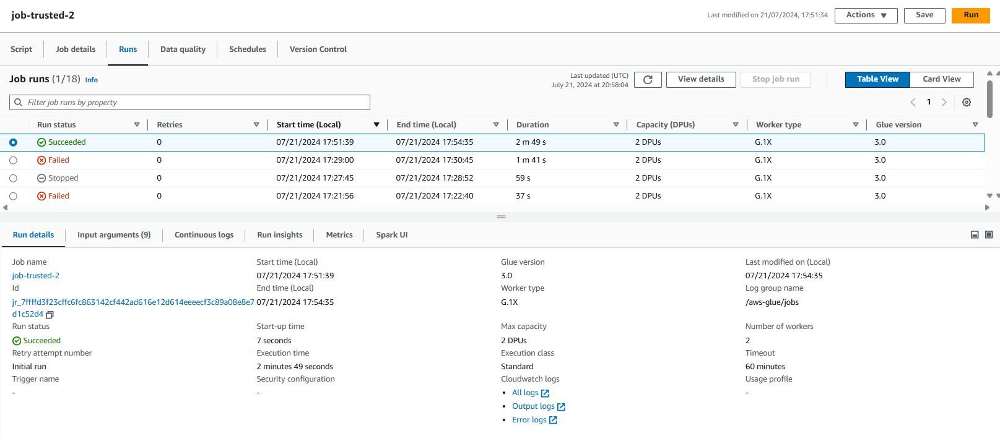

## Crawler tabela refined

Aqui pensei em fazer igual foi feito na sprint 2, fiz uma tabela com os dados consolidados depois fui separando em dimensões

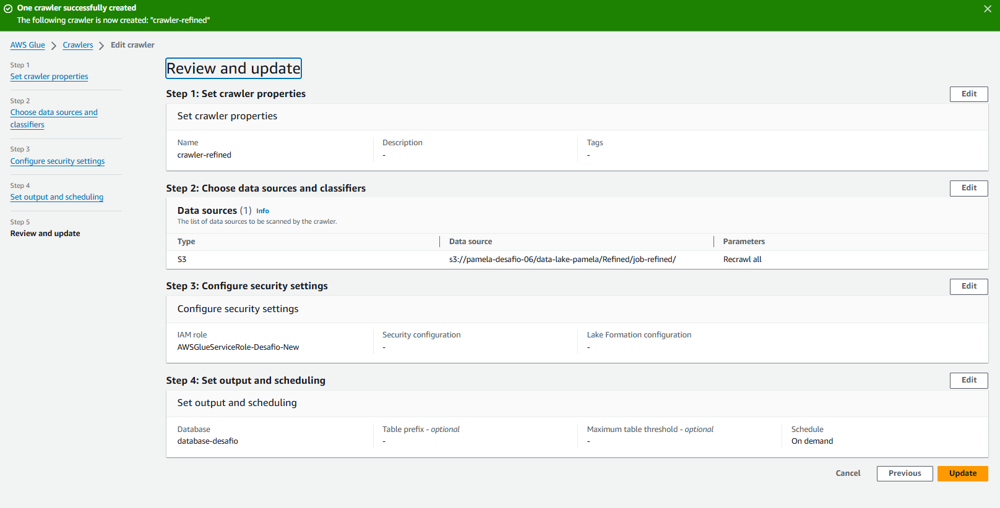
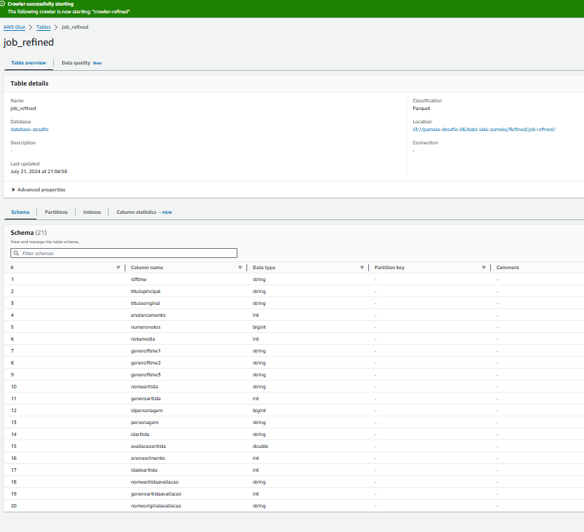
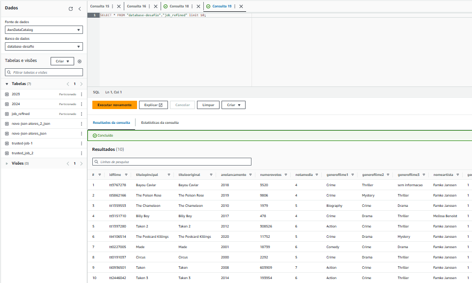

## Criação do script para modelagem dos dados e criação das views

Nessa parte eu queria criar as tabelas e as views em um script só, e além disso queria salvar as tabelas no Glue Catalog. Na sprint passada não consegui fazer isso, queria tentar, e como nessa eu estava dentro do prazo, e conversando com o monitor, tentei e entendi o processo de como usar dinamicFrame e DataFrame

###  diagrama das tabelas e as dimensôes

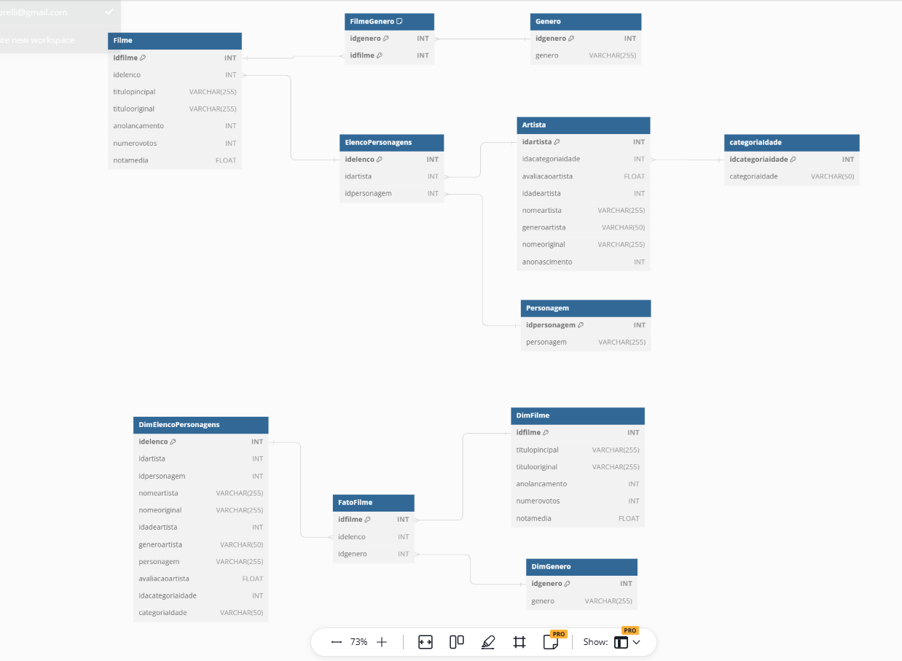


```
import sys
from awsglue.transforms import *
from pyspark.sql import SparkSession
from pyspark.sql.functions import col, when, monotonically_increasing_id, coalesce, lit
from pyspark.sql.types import IntegerType
from pyspark.sql.functions import udf
from awsglue.utils import getResolvedOptions
from pyspark.context import SparkContext
from awsglue.context import GlueContext
from awsglue.job import Job
from awsglue.dynamicframe import DynamicFrame

# Argumentos do Job
args = getResolvedOptions(sys.argv, ['JOB_NAME'])
sc = SparkContext()
glueContext = GlueContext(sc)
spark = glueContext.spark_session
job = Job(glueContext)
job.init(args['JOB_NAME'], args)

# Caminhos de saída
output_path = 's3://pamela-desafio-06/data-lake-pamela/Refined/modelagem/'
dimensoes_output_path = 's3://pamela-desafio-06/data-lake-pamela/Refined/dimensoes/'

# Função para salvar no Glue Catalog
def save_to_glue_catalog(df, output_path, database, table_name):
    dynamic_frame = DynamicFrame.fromDF(df, glueContext, table_name)
    sink = glueContext.getSink(connection_type="s3", path=output_path,
                               enableUpdateCatalog=True, updateBehavior="UPDATE_IN_DATABASE",
                               partitionKeys=[], compression="snappy")
    sink.setFormat("glueparquet")
    sink.setCatalogInfo(catalogDatabase=database, catalogTableName=table_name)
    sink.writeFrame(dynamic_frame)

# Leitura do DataFrame
df = glueContext.create_dynamic_frame.from_catalog(
    database="database-desafio",
    table_name="job_refined"
).toDF()

# tabela categoriaidade
# Obtendo os valores únicos da coluna 'categoriaidade'
valores_unicos = df.select("categoriaidade").distinct()

# Mapeiando os IDs para as categorias correspondentes
regra_ids = {
    "juvenil": 1,
    "adultos": 2,
    "maduros": 3,
    "idosos": 4
}

# Crie uma nova tabela com os IDs e os nomes das categorias
categoriaidade = valores_unicos.withColumn(
    "idcategoriaidade",
    when(valores_unicos["categoriaidade"] == "juvenil", 1)
    .when(valores_unicos["categoriaidade"] == "adultos", 2)
    .when(valores_unicos["categoriaidade"] == "maduros", 3)
    .when(valores_unicos["categoriaidade"] == "idosos", 4)
    .otherwise(None)
)

categoriaidade = categoriaidade.select("idcategoriaidade", "categoriaidade")
categoriaidade.show(5)

# tabela artista
# Obtendo os valores únicos da coluna 'categoriaidade'
valores_unicos = categoriaidade.select("idcategoriaidade", "categoriaidade").distinct()
artista = df.join(valores_unicos, on="categoriaidade", how="inner")

# Selecione as colunas desejadas
artista = artista.select("idartista", "idcategoriaidade", "nomeartista", "generoartista",
                         "nomeoriginalavaliacao", "anonascimento",
                         "idadeartista", "avaliacaoartista" ).distinct()

# Renomeia a coluna nomeoriginalavaliacao para nomeoriginal
artista = artista.withColumnRenamed("nomeoriginalavaliacao", "nomeoriginal")
artista.show(5)

# tabela personagem
personagem = df.select(
    'idpersonagem', 'personagem'
).distinct()
personagem.show(5)

# tabela elencopersonagem
# Selecionar as colunas relevantes e adicionar IDs
elencopersonagem = df.select(
    'idpersonagem', 'idartista'
).distinct()

# Adicionar uma coluna de IDs usando monotonically_increasing_id
elencopersonagem = elencopersonagem.withColumn('idelenco', monotonically_increasing_id())
elencopersonagem = elencopersonagem.select('idelenco', 'idpersonagem', 'idartista')
elencopersonagem.show(5)

# tabela genero
# Dicionário de mapeamento dos IDs para os gêneros
genero_ids = {
    "sem informacao": 0,
    "Crime": 1,
    "Drama": 2,
    "Documentary": 3,
    "Biography": 4,
    "Comedy": 5,
    "Action": 6,
    "Thriller": 7,
    "Adventure": 8,
    "War": 9,
    "Mystery": 10,
    "Horror": 11,
    "Romance": 12,
    "Fantasy": 13,
    "Sci-Fi": 14
}

# Função UDF para mapear o gênero para o ID correspondente
def genero_para_id(genero):
    return genero_ids.get(genero, None)

genero_para_id_udf = udf(genero_para_id, IntegerType())

# Obtendo os valores únicos das colunas
categorias1 = df.select("generofilme1").distinct().withColumnRenamed("generofilme1", "generofilme")
categorias2 = df.select("generofilme2").distinct().withColumnRenamed("generofilme2", "generofilme")
categorias3 = df.select("generofilme3").distinct().withColumnRenamed("generofilme3", "generofilme")

# Combinando as categorias únicas das três colunas
categorias_gerais = categorias1.union(categorias2).union(categorias3).distinct()

# Adicionando a coluna de IDs utilizando a função UDF
genero = categorias_gerais.withColumn("idgenero", genero_para_id_udf("generofilme"))

# Selecionando as colunas 'idgenero' e 'generofilme'
genero = genero.select("idgenero", "generofilme")
genero.show(20)

# tabela filmegenero
# obter os generos das três colunas do df
filmegenero1 = df.join(genero, df.generofilme1 == genero.generofilme) \
                 .select(df.idfilme, genero.idgenero)

filmegenero2 = df.join(genero, df.generofilme2 == genero.generofilme) \
                 .select(df.idfilme, genero.idgenero)

filmegenero3 = df.join(genero, df.generofilme3 == genero.generofilme) \
                 .select(df.idfilme, genero.idgenero)

# Unir os resultados dos três DataFrames
filmegenero = filmegenero1.union(filmegenero2).union(filmegenero3)

# Remover linhas duplicadas
filmegenero = filmegenero.dropDuplicates()
filmegenero.show(5)

# Tabela filme
# Realizar o join diretamente com DataFrames
filme = df.join(elencopersonagem, df.idpersonagem == elencopersonagem.idpersonagem, how="left") \
    .select(
        df.idfilme,
        df.titulopincipal,
        df.titulooriginal,
        df.anolancamento,
        df.numerovotos,
        df.notamedia,
        elencopersonagem.idelenco
    )

filme = filme.select("idfilme", "idelenco", "titulopincipal", "titulooriginal",
                     "anolancamento", "numerovotos", "notamedia")
filme.show(5)

filme.createOrReplaceTempView("filme")
artista.createOrReplaceTempView("artista")
categoriaidade.createOrReplaceTempView("categoriaidade")
personagem.createOrReplaceTempView("personagem")
genero.createOrReplaceTempView("genero")
filmegenero.createOrReplaceTempView("filmegenero")

# tabelas dimensoes
# Supondo que df seja seu DataFrame com dados da tabela Filme
dimfilme = df.select(
    'idfilme', 'titulopincipal', 'titulooriginal', 'anolancamento',
    'numerovotos', 'notamedia'
).distinct()
dimfilme.createOrReplaceTempView("dimfilme")

# Unir as tabelas com aliases
dimelencopersonagem = elencopersonagem.alias("ep") \
    .join(artista.alias("a"), col("ep.idartista") == col("a.idartista"), "left") \
    .join(categoriaidade.alias("c"), col("c.idcategoriaidade") == col("a.idcategoriaidade"), "left") \
    .join(personagem.alias("p"), col("ep.idpersonagem") == col("p.idpersonagem"), "left") \
    .select(
        col("ep.idelenco"),
        col("ep.idpersonagem"),
        col("ep.idartista"),
        col("a.nomeartista"),
        col("a.nomeoriginal"),
        col("a.idadeartista"),
        col("a.generoartista"),
        col("a.anonascimento"),
        col("a.avaliacaoartista"),
        col("p.personagem"),
        col('c.idcategoriaidade'),
        col('c.categoriaidade')  # Certifique-se de que o nome da coluna está correto
    ) \
    .distinct()
dimelencopersonagem.createOrReplaceTempView("dimelencopersonagem")

dimgenero = filmegenero.alias('fg') \
    .join(
        genero.alias('g'),
        coalesce(col('fg.idgenero'), lit(-1)) == coalesce(col('g.idgenero'), lit(-1)),
        'inner'
    ).select(
        col('fg.idgenero'),
        col('g.generofilme'),
        col('fg.idfilme')
    ).distinct()
dimgenero.createOrReplaceTempView("dimgenero")

dimfilme.show(5)
dimelencopersonagem.show(5)
dimgenero.show(5)

df.createOrReplaceTempView("df")

# Unir as tabelas para criar a tabela fato
fatofilme = filme.alias("f") \
    .join(dimfilme.alias("d"), col("f.idfilme") == col("d.idfilme"), "left") \
    .join(dimelencopersonagem.alias("e"), col("f.idelenco") == col("e.idelenco"), "left") \
    .join(dimgenero.alias("g"), col("f.idfilme") == col("g.idfilme"), "left") \
    .select(
        col("d.idfilme"),
        col("e.idelenco"),
        col("g.idgenero"),
    ) \
    .distinct()

# tabela temporária para a tabela fato
fatofilme.createOrReplaceTempView("fatofilme")
fatofilme.show(5)

# Salvando as dimensões no Glue Catalog
save_to_glue_catalog(filme, output_path + 'filme/', "modelagem-dimensoes", "filme")
save_to_glue_catalog(artista, output_path + 'artista/', "modelagem-dimensoes", "artista")
save_to_glue_catalog(categoriaidade, output_path + 'categoriaidade/', "modelagem-dimensoes", "categoriaidade")
save_to_glue_catalog(personagem, output_path + 'personagem/', "modelagem-dimensoes", "personagem")
save_to_glue_catalog(genero, output_path + 'genero/', "modelagem-dimensoes", "genero")
save_to_glue_catalog(filmegenero, output_path + 'filmegenero/', "modelagem-dimensoes", "filmegenero")

save_to_glue_catalog(dimfilme, output_path + 'dimfilme/', "modelagem-dimensoes", "dimfilme")
save_to_glue_catalog(dimelencopersonagem, output_path + 'dimelencopersonagem/', "modelagem-dimensoes", "dimelencopersonagem")
save_to_glue_catalog(dimgenero, output_path + 'dimgenero/', "modelagem-dimensoes", "dimgenero")
save_to_glue_catalog(fatofilme, output_path + 'fatofilme/', "modelagem-dimensoes", "fatofilme")

job.commit()

```

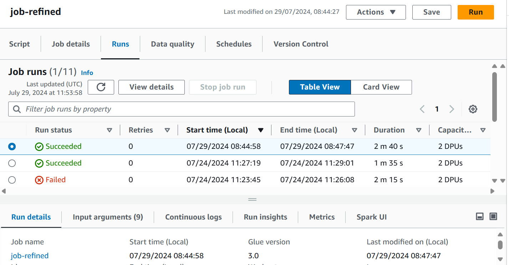
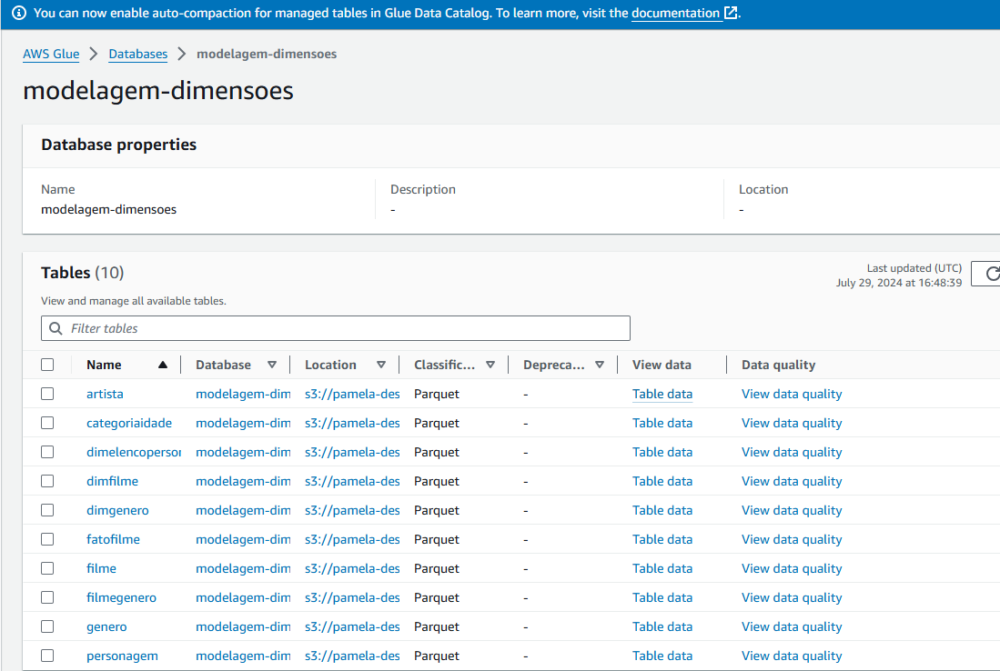
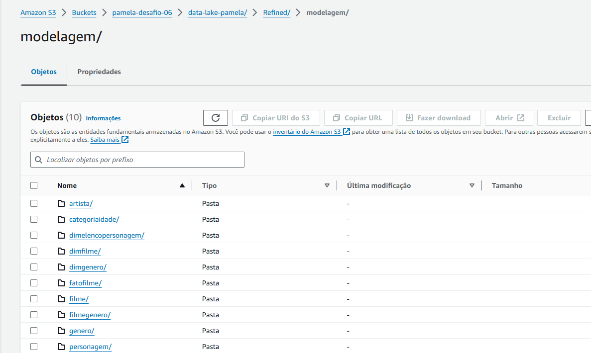

## Tabelas

## Tabelas artistas

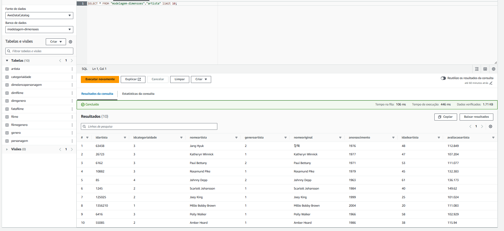

## Tabelas filme

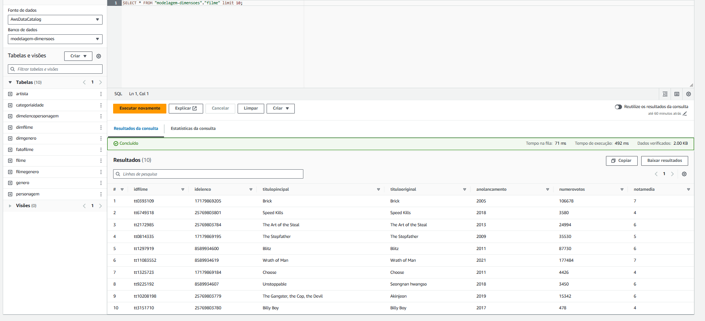

## Tabelas categoriaidade

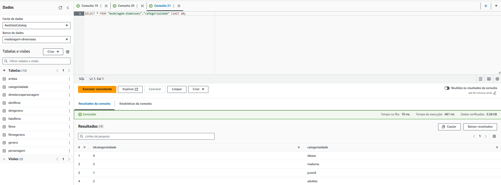


## Tabelas personagem

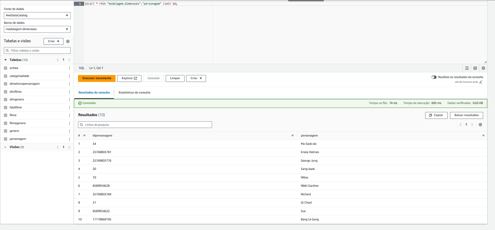

## Tabelas genero

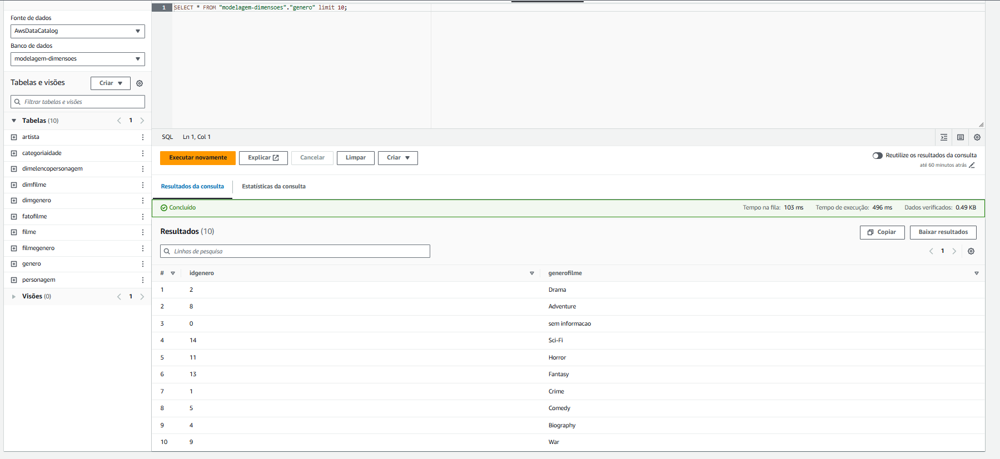

## Tabelas filmegenero

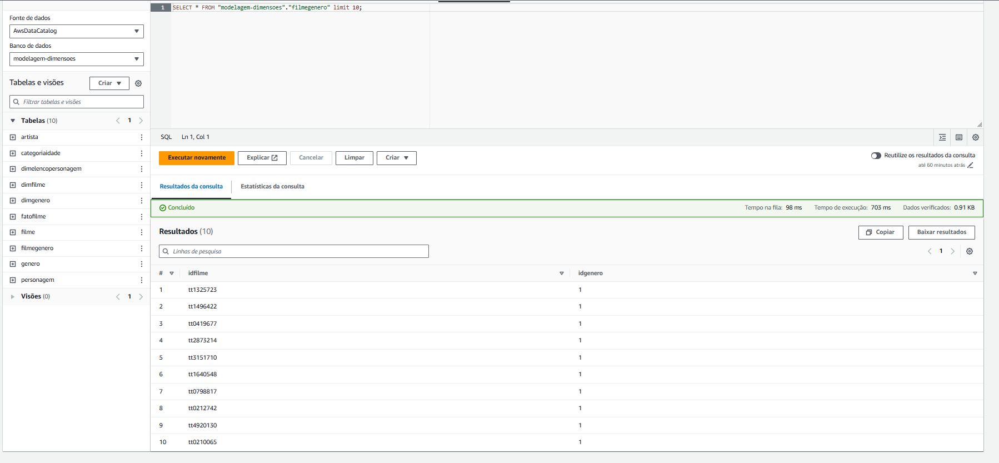


## Dimensões

## FatoFilme
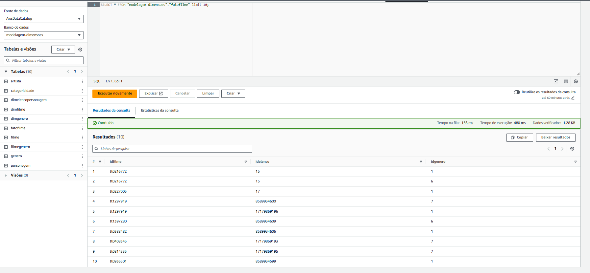

## Dimensão Elenco Personagem 

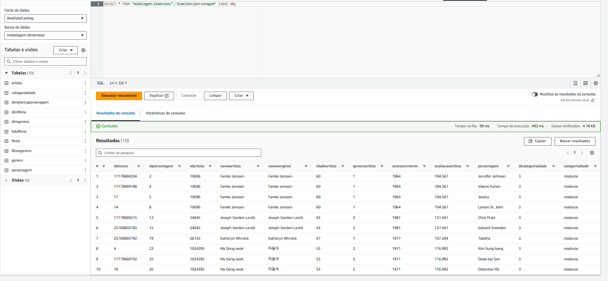

## Dimensão Filme

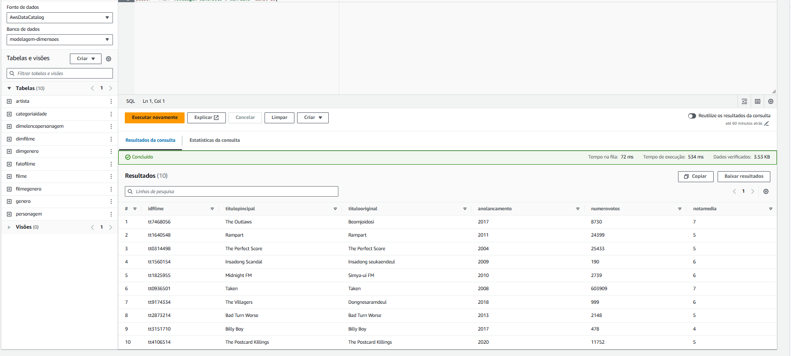

## Dimensão Genero
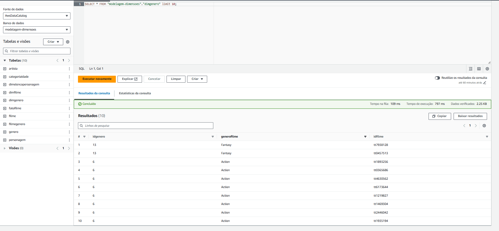

## Views
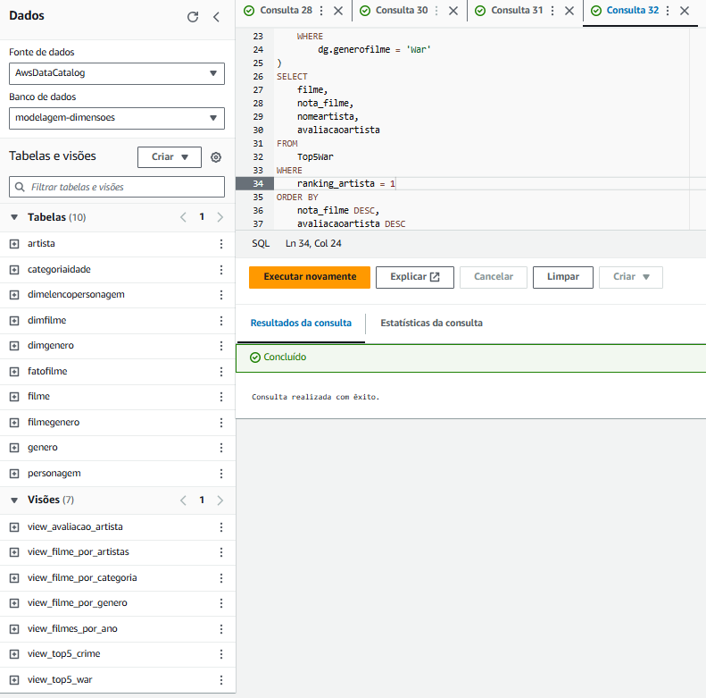


